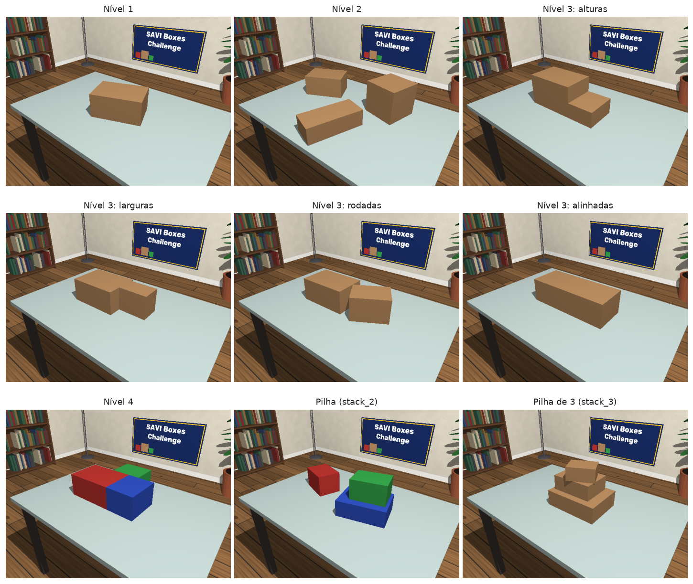
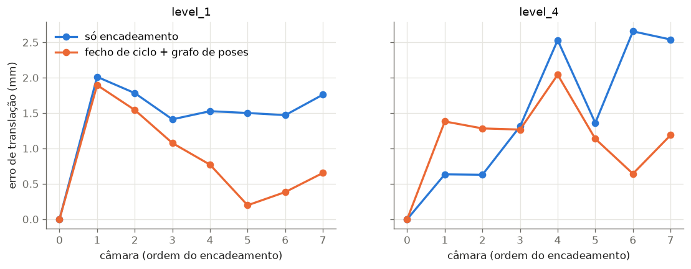
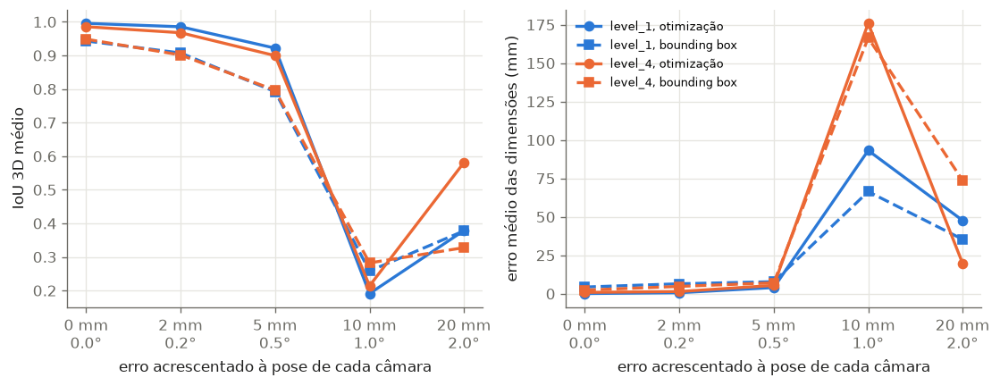
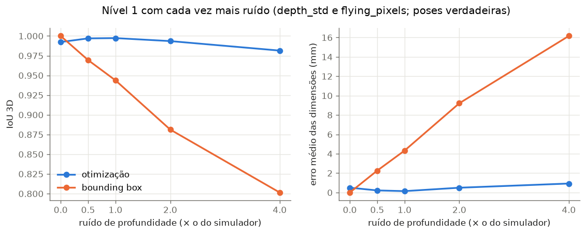
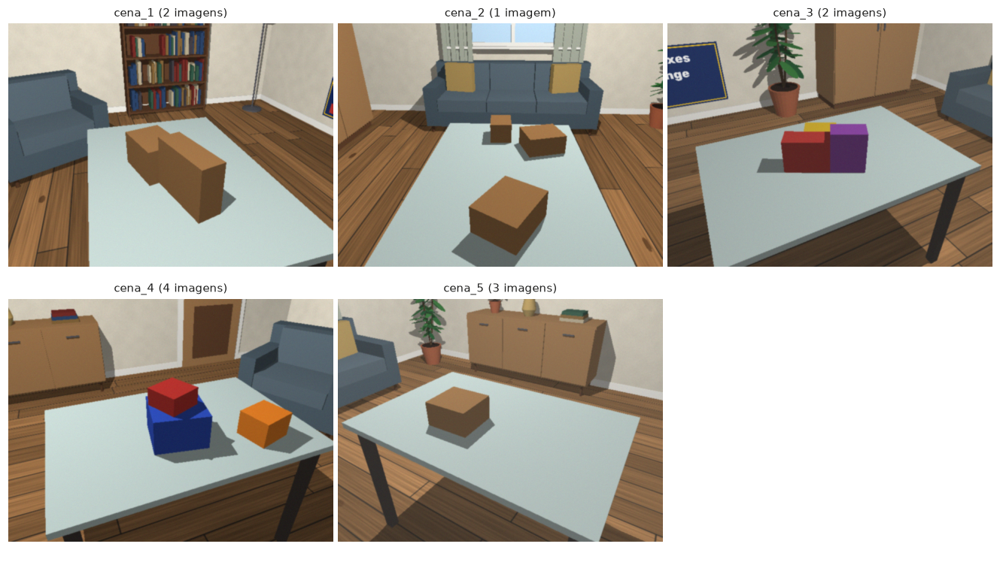
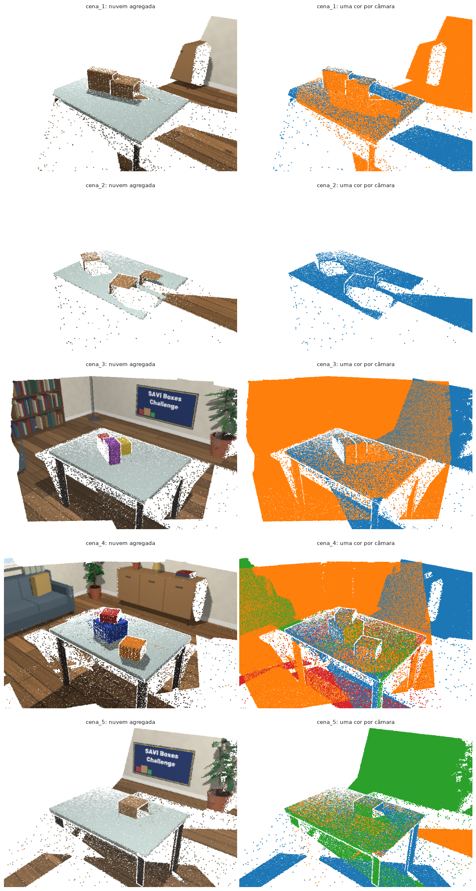
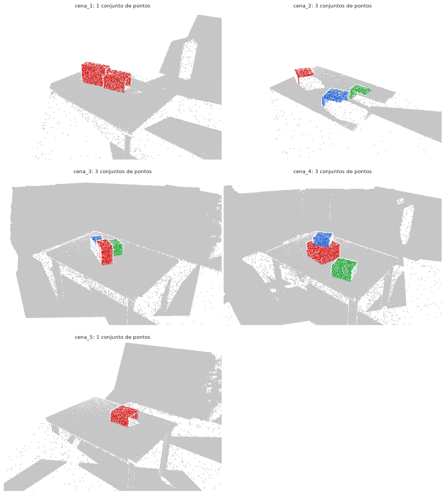

# SAVIBoxes — Trabalho Prático 1 de SAVI

Estimação da pose e das dimensões de caixas sobre uma mesa, a partir de várias imagens RGB-D. O sistema tem quatro
etapas, que correm por esta ordem e passam os resultados umas às outras:

```
imagens RGB-D ──► Parte 1: registo ──► extra: fotometria ──► Parte 2: segmentação ──► Parte 3: ajuste ──► result.json
                  (poses das câmaras,   (s e b de cada        (mesa, objetos,           (bounding box e
                   nuvem agregada)       imagem, cores)        conjuntos de pontos)      otimização)
```

Neste relatório explicamos a abordagem de cada parte e a origem de cada técnica, respondemos às questões do
enunciado e descrevemos as dificuldades que encontrámos. As respostas às questões apoiam-se em experiências feitas
com as nossas [cenas de desenvolvimento](#cenas-de-desenvolvimento). Os resultados nas cenas do teste estão no fim,
em [Resultados do teste](#resultados-do-teste); essa secção é gerada pelo `run_test.py` depois de correr as cenas.

## Índice

1. [Como correr](#como-correr)
2. [Cenas de desenvolvimento](#cenas-de-desenvolvimento)
3. [Parte 1 — Registo](#parte-1--registo)
4. [Parte 2 — Segmentação](#parte-2--segmentação)
5. [Parte 3 — Ajuste das caixas](#parte-3--ajuste-das-caixas)
6. [Níveis de dificuldade](#níveis-de-dificuldade)
7. [Extras](#extras)
8. [Dificuldades encontradas](#dificuldades-encontradas)
9. [Resultados do teste](#resultados-do-teste)

**Fontes.** Em cada técnica indicamos de onde vem:

| sigla | fonte |
|---|---|
| **P02 … P08** | aulas da disciplina, repositório [`SAVI_26-27`](https://github.com/miguelriemoliveira/SAVI_26-27), pasta `ParteXX` e número do exercício |
| **O3D** | tutoriais e documentação do [Open3D](https://www.open3d.org/docs/release/) (com o nome do tutorial) |
| **CV** | documentação do OpenCV |
| **SP** | documentação do SciPy (`scipy.optimize.least_squares`) |
| **Nosso** | não vem das aulas nem de um tutorial: criado por nós para resolver um problema que encontrámos |

---

## Como correr

```
pip install -r requirements.txt
python run_test.py --scenes <pasta com as cenas> --output results_test   # todas as partes e o avaliador, em cada cena
python savi/parte1_registo.py --scene <cena> --visualize                 # cada parte em separado, com janelas 3D
python savi/extra_fotometria.py --scene <cena> --visualize
python savi/parte2_segmentacao.py --scene <cena> --visualize
python savi/parte3_ajuste.py --scene <cena> --visualize                  # escreve o result.json
python savi/avaliador.py --scene <cena> --num_boxes 3                    # compara com o ground truth (avaliacao.md)
```

Cada parte lê o que a anterior gravou em `<cena>/partes/`. As partes nunca leem o `ground_truth.json`: só o
avaliador o usa. O código está em `savi/`; em `docs/` estão as figuras deste relatório, os scripts das experiências
(`experiencias.py`, `gerar_figuras.py`) e os seus resultados (`docs/resultados/*.json`).

---

## Cenas de desenvolvimento

Gerámos estas cenas com o simulador, a partir das configurações em [`simulator/configs`](simulator/configs). Todas têm
8 câmaras em anel e o ruído por omissão.



| configuração | nível | o que tem |
|---|---|---|
| `level_1` | 1 | uma caixa |
| `level_2` | 2 | 3 caixas separadas, da mesma cor |
| `level_3_heights`, `_widths`, `_rotated` | 3 | 2 caixas em contacto: alturas diferentes; larguras diferentes; rodadas entre si |
| `level_3_aligned` | 3 | 2 caixas com a mesma secção, perfeitamente alinhadas (caso impossível) |
| `level_4` | 4 | 3 caixas em contacto, de cores diferentes |
| `stack_1`, `stack_2`, `stack_3` | 3 e 4 | pilhas: 2 da mesma cor; 2 de cores diferentes + 1 isolada; torre de 3 da mesma cor |
| `level_4_cores_proximas` | extra | o `level_4` com laranja e castanho em vez de vermelho e azul |

---

## Parte 1 — Registo

Ficheiro: [`savi/parte1_registo.py`](savi/parte1_registo.py). Objetivo: a pose `T_camera0_camera` de cada câmara e a
nuvem agregada no referencial da câmara 000.

As câmaras formam um anel. Registamos cada câmara com a vizinha (pares 0→1, 1→2, …) pelos 4 passos do enunciado e
encadeamos as poses: `T_0_(i+1) = T_0_i · T_i_(i+1)`.

### Passo 1 — Pré-processamento

| técnica | o que faz | parâmetros | fonte |
|---|---|---|---|
| filtro de profundidade | retira os pontos a mais de 3 m da câmara, antes do ICP | `MAX_DEPTH = 3 m` | **Nosso** (o ruído cresce com z²: a 4 m já é ~2.5 cm) |
| `voxel_down_sample` | um ponto por cubo: densidade uniforme e menos pontos | 4 escalas: 4, 2, 1 e 0.5 cm | **P07** Ex. 4; **P08** Ex. 2 |
| `remove_statistical_outlier` | retira pontos longe dos vizinhos (os *flying pixels* das arestas) | 20 vizinhos, 2 σ | **O3D** "Point cloud outlier removal" |
| `estimate_normals` | normal de cada ponto (o ICP ponto-a-plano precisa delas) | raio 3 × voxel, 30 vizinhos | **P07** Ex. 5 |

O pré-processamento faz-se uma vez por imagem e por escala do ICP. Sem o filtro de profundidade, o erro de registo
chegou a ser 24 vezes maior (`level_2` com 5 câmaras: 1.3 mm com o filtro, 30 mm sem ele).

### Passo 2 — Estimativa inicial

Cada ponto da nuvem vem de um pixel. Projetando a nuvem com a matriz K obtemos o ponto 3D de cada pixel, e as
associações entre *features* das imagens passam a ser pares de pontos 3D (nota da P08, Ex. 3).

| técnica | o que faz | fonte |
|---|---|---|
| `cv2.SIFT_create` | *keypoints* e descritores em cada imagem | **P04** Ex. 2 |
| FLANN (`knnMatch`, k = 2) + teste da razão de Lowe (0.8) | associa os descritores e retira as associações ambíguas | **P04** Ex. 3 e 4 |
| pixel → ponto 3D | o pixel de cada *keypoint* dá o ponto 3D da nuvem (projeção com K) | **P08** Ex. 3 |
| `registration_ransac_based_on_correspondence` | transformação rígida a partir dos pares 3D, robusta às associações erradas, com os *checkers* de comprimento das arestas e de distância | **O3D** "Global registration" (para o qual a P08 remete) |
| RANSAC repetido sem os *inliers* anteriores | várias hipóteses por par (texturas repetidas dão modelos errados com muitos *inliers*) | ideia da deteção sucessiva de planos da **P07** Ex. 3 |
| ASIFT (`cv2.AffineFeature`) | quando o SIFT dá poucas associações: simula inclinações da imagem e dá 3 a 10 vezes mais associações corretas | **CV** (não está nas aulas) |
| hipóteses da mesa | cada câmara deteta sozinha o tampo (função da Parte 2); `T_a_b = T_a_mesa · Rz(0° ou 180°) · T_b_mesa⁻¹` fica a ~1 cm da solução | **Nosso** |

Entre câmaras a 45°, o SIFT dá só 2 a 13 associações corretas em centenas. As *features* 3D (FPFH, **O3D** "Global
registration") falharam em todos os pares: a cena está cheia de planos com descritores iguais.

### Passo 3 — ICP

| técnica | o que faz | fonte |
|---|---|---|
| `registration_icp` com `TransformationEstimationPointToPlane` | refina cada hipótese sobre a **nuvem completa** (mesa, caixas e fundo), como o enunciado pede | **P08** Ex. 2 |
| ICP multi-escala | 4 escalas, do grosseiro para o fino (voxel 4 cm → 5 mm, distância máxima 1.5 × voxel) | **P08** Ex. 2.3; **O3D** "Colored point cloud registration" (multi-escala) |
| kernel robusto de Tukey (`TukeyLoss`) | reduz o peso dos pares errados no ICP | **O3D** "Robust kernels" |
| escolha da hipótese | fica a que melhor alinha as nuvens completas: pontos a menos de 2 cm **e** com cor parecida | **Nosso** |

### Passo 4 — Agregação

| técnica | o que faz | fonte |
|---|---|---|
| encadeamento das poses | `T_0_(i+1) = T_0_i · T_i_(i+1)` | **P08** Ex. 3 |
| grafo de poses com fecho de ciclo | aresta extra 7 → 0 e otimização do grafo (`PoseGraph`, `global_optimization`), que distribui o erro pelo anel | **O3D** "Multiway registration" |
| agregação na resolução original | cada nuvem original (sem *downsampling*) é transformada para o referencial da câmara 000 e juntada | **P08** Ex. 3 |

### Extras de robustez

Foram necessários para o registo não falhar com poucas câmaras (2 a 4, num arco) ou com texturas repetidas. São
todos **Nosso**.

- **Validação de cada par:** se o melhor alinhamento tiver um *score* baixo (< 0.18; os pares corretos dão
  0.26–0.48), repetimos com mais esforço (ASIFT, Lowe 0.9, 10 hipóteses). Se continuar baixo, a aresta não é usada e
  a câmara é posicionada pelo outro lado do anel. Num teste, um só par falhado punha uma câmara a 840 mm do sítio (e
  todas as seguintes); com a validação, o erro máximo ficou em 1.2 mm.
- **Câmara acima da mesa:** uma hipótese só é aceite se cada câmara ficar pelo menos 10 cm acima do tampo visto pela
  outra (as hipóteses erradas do chão punham a câmara 2.2 m abaixo da mesa).
- **Espaço livre:** entre a câmara e a superfície medida em cada pixel não há nada. Uma hipótese que põe mais de 10%
  dos pontos da outra câmara nesse espaço é descartada (corretas: 1–5%; erradas: 19–40%).
- **Exposição:** antes de comparar as cores de um par no *score*, corrigimos a exposição da fonte para a do alvo
  (`exposure_corrected`, P06 Ex. 2.2). Sem isto, com Exposure changes, todas as hipóteses tinham *score* ~0.003.

### Questões da Parte 1

**O que acontece ao ICP se retirar o fundo e deixar apenas a mesa e as caixas? Porquê?**

Corremos o ICP multi-escala em cada par de câmaras vizinhas a partir da pose verdadeira com um erro acrescentado
(3, 8 e 15 cm com 3°, 8° e 15°, em 5 direções), com a nuvem completa e só com a mesa e as caixas. "Converge" =
acaba a menos de 5 mm e 0.5° da pose verdadeira (35 ICP por linha).

| cena | erro inicial | converge: completa / sem fundo | erro final, mediana | erro final, percentil 90 |
|---|---|---|---|---|
| `level_1` | 3 cm, 3° | 97% / 100% | 0.1 / 0.1 mm | 2 / 1 mm |
| | 8 cm, 8° | 63% / 66% | 0.3 / 0.2 mm | 469 / **1575** mm |
| | 15 cm, 15° | 23% / 26% | 332 / 574 mm | 1023 / **2975** mm |
| `level_4` | 3 cm, 3° | 100% / 100% | **0.8 / 2.0** mm | 2 / 4 mm |
| | 8 cm, 8° | 69% / 74% | **0.9 / 2.5** mm | 422 / **854** mm |
| | 15 cm, 15° | 29% / 37% | 307 / 150 mm (não se mexeu) | 652 / **2024** mm |

- **Converge quase as mesmas vezes:** a bacia de convergência (~5–8 cm) é definida pela escala mais grosseira do ICP,
  por isso a estimativa inicial tem de ficar a poucos cm nos dois casos.
- **Fica menos exato** (0.8 → 2.0–2.5 mm no `level_4`): a mesa é um plano e só fixa 3 graus de liberdade (altura e
  inclinações); a nuvem pode deslizar sobre ela e rodar em torno da normal. Os outros 3 ficam a cargo das faces
  laterais das caixas, que têm poucos pontos. O fundo (paredes, móveis) traz muitas superfícies com orientações
  diferentes e torna o problema bem condicionado.
- **Quando falha, falha muito pior:** sem nada à volta, a nuvem escorrega pelo plano da mesa (percentil 90 de 1.6 a
  3 m, contra 0.4 a 1 m com o fundo).

**O que acontece ao erro quando encadeia muitas imagens? A última imagem alinha com a primeira?**

Corremos o registo nas mesmas cenas só com encadeamento (`--no_loop_closure`) e com fecho de ciclo e grafo de poses.



| cena | método | erro da câmara 007 | erro máximo |
|---|---|---|---|
| `level_1` | só encadeamento | 1.8 mm | 2.0 mm, 0.10° |
| | fecho de ciclo + grafo de poses | 0.7 mm | 1.9 mm, 0.07° |
| `level_4` | só encadeamento | 2.5 mm | 2.7 mm, 0.05° |
| | fecho de ciclo + grafo de poses | 1.2 mm | 2.0 mm, 0.06° |

- **O erro acumula-se:** a pose da câmara i é o produto das transformações de todos os pares até ela, e o erro de
  cada par passa para todas as câmaras seguintes. Como os erros têm direções aleatórias, crescem em média com √n
  (no `level_4`, 0.6 mm na 001 e 2.5–2.7 mm nas últimas). Um par errado estraga todas as câmaras a seguir.
- **A última imagem não alinha exatamente com a primeira:** a 007 fica a 1.8–2.5 mm do sítio, quando um só ICP erra
  0.1–1 mm. Aqui o desfasamento é pequeno porque cada ICP é muito preciso e o anel só tem 8 câmaras; com mais
  imagens ou pares piores, cresce.
- **O fecho de ciclo** (aresta 7 → 0) distribui o desfasamento pelo anel: as últimas câmaras melhoram mais
  (1.8 → 0.7 mm e 2.5 → 1.2 mm); as primeiras recebem parte do erro das outras.

**Que efeito têm os erros de registo na nuvem de pontos agregada?**

Acrescentámos às poses verdadeiras (exceto à da 000) um erro de tamanho fixo em direção aleatória e corremos as
Partes 2 e 3 sobre a nuvem agregada assim obtida:



| erro em cada câmara | `level_1`: caixas / IoU otim. / IoU bbox | `level_4`: caixas / IoU otim. / IoU bbox |
|---|---|---|
| 0 | 1 / **0.996** / 0.943 | 3 / **0.986** / 0.948 |
| 2 mm e 0.2° | 1 / **0.985** / 0.907 | 3 / **0.968** / 0.901 |
| 5 mm e 0.5° | 1 / **0.922** / 0.792 | 4 / **0.899** / 0.796 |
| 10 mm e 1° | **5** / 0.191 / 0.258 | 3 / 0.214 / 0.282 |
| 20 mm e 2° | **6** / 0.379 / 0.378 | 4 / 0.581 / 0.328 |

Cada câmara põe as faces das caixas num sítio ligeiramente diferente, por isso as faces ficam **duplicadas ou
engrossadas**. A rotação pesa mais do que a translação: a ~1.2 m, 1° já desloca os pontos ~2 cm.
- **Até ~2 mm e 0.2°:** a otimização fica na média das cópias e quase não perde; a bounding box encosta-se à cópia
  mais de fora e cresce.
- **5 mm e 0.5°:** erros de 4–5 mm nas dimensões e uma caixa a mais no `level_4`.
- **≥ 1 cm e 1°:** as cópias ficam a mais de 1.5 cm umas das outras, a segmentação vê várias caixas e os dois
  métodos falham.

O registo tem, por isso, de ficar na ordem de 1–2 mm e abaixo de 0.1°; nas cenas de desenvolvimento ficou, no
máximo, em 3.1 mm e 0.09°.

---

## Parte 2 — Segmentação

Ficheiro: [`savi/parte2_segmentacao.py`](savi/parte2_segmentacao.py). A segmentação é feita sobre a nuvem agregada e
segue a estrutura da solução da P08, Ex. 4 (chão → mesa → referencial da mesa → objetos → *clusters*).

| passo | técnica | fonte |
|---|---|---|
| 1. Mesa | normais (P07 Ex. 5) e só os pontos de superfícies horizontais, normal a menos de 10° da vertical (θ = arccos\|n·up\|) | **P07** Ex. 6 e 8 (RANSAC guiado pelas normais) |
| | **chão** = maior plano horizontal (`segment_plane`, RANSAC) | **P07** (`segment_plane`); **P08** Ex. 4 |
| | **mesa** = RANSAC nos pontos entre 0.5 e 1.0 m acima do chão; maior componente ligada do plano (DBSCAN) | **P08** Ex. 4 |
| | sentido "para cima": plano dos pontos do centro das imagens, com a normal virada para as câmaras (na P08 escolhe-se à mão) | **Nosso** |
| | referencial da mesa: origem no centro do tampo, z para cima, x ao longo do comprimento (`cv2.minAreaRect` do tampo) | **P08** Ex. 4; **CV** (`minAreaRect`) |
| 2. Retirar mesa e fundo | pontos entre 8 mm e 60 cm acima da mesa e dentro dos limites do tampo; voxel de 4 mm e remoção de *outliers* | **P08** Ex. 4 (lá até 40 cm; aqui há pilhas) |
| 3. *Clustering* | `cluster_dbscan`, eps = 1.5 cm; os *clusters* pequenos ficam de fora | **P07** Ex. 4; **P08** Ex. 4 |
| 4. Cor (Nível 4) | k-means (`cv2.kmeans`) na cromaticidade r = R/(R+G+B), g = G/(R+G+B), dentro de cada *cluster* com várias caixas; só se os grupos estiverem bem separados (distância entre centros > 4 × dispersão) | separar cor de brilho como o HSV da **P02**; k-means do **CV** |
| extra: n.º de caixas | o número de caixas não é dado: é estimado em cada *cluster* (ver [Número de caixas desconhecido](#número-de-caixas-desconhecido)) | **Nosso** |

**Porquê a cromaticidade:** uma sombra multiplica R, G e B pelo mesmo fator, que se cancela na divisão, por isso
todas as faces de uma caixa ficam com a mesma cor. A primeira versão usava (a\*, b\*) do Lab, que não cancela o
fator: nas faces escuras, um azul e um roxo deixaram de se distinguir (IoU 0.00–0.58; com (r, g), 0.99). O `inRange`
da P02 não serve, porque precisa de limites de cor conhecidos.

---

## Parte 3 — Ajuste das caixas

Ficheiro: [`savi/parte3_ajuste.py`](savi/parte3_ajuste.py). Dois métodos, aplicados aos mesmos conjuntos de pontos.

### Método base: bounding box

| técnica | o que faz | fonte |
|---|---|---|
| `get_minimal_oriented_bounding_box()` | caixa de menor volume de cada conjunto | **O3D**; **P08** Ex. 5 |
| *outliers* | `remove_statistical_outlier` e maior componente ligada (DBSCAN) | **O3D**; **P07** Ex. 4 |
| pontos extremos | cada dimensão vai do percentil 0.5 ao 99.5, e não do mínimo ao máximo | **Nosso** |
| referencial da caixa | o eixo mais alinhado com o z da mesa passa a ser a altura; a base é posta na mesa (ou no topo da caixa de baixo) | **P08** Ex. 5 ("o eixo z da OBB fica perpendicular à mesa?" — não fica) |

O corte dos percentis subiu o IoU médio da bounding box de 0.768 para 0.810. A `get_oriented_bounding_box()` (PCA)
foi sempre pior (IoU 0.55 contra 0.77).

### Método principal: ajuste por otimização

Como nas P05 e P06, a função objetivo recebe os dados com `partial(objective_function, data=problem)` e devolve um
vetor de erros que o `least_squares` minimiza. Todas as caixas são ajustadas ao mesmo tempo.

| item do enunciado | o que fizemos | fonte |
|---|---|---|
| 1. Parâmetros | por caixa `x, y, yaw, length, width, height, z`, no referencial da mesa; `z` fixo em 0 nas caixas assentes na mesa | enunciado; **P05** (vetor de parâmetros) |
| 2. Função objetivo | **um erro por ponto**: distância à face mais próxima com orientação compatível com a normal do ponto, na caixa que melhor o explica (`min` sobre as caixas) | **P05**, **P06** Ex. 2.3 (um erro por pixel) |
| | **cobertura** (modelo → dados): amostras nas faces visíveis de cada caixa têm de ter pontos por perto | **Nosso** |
| | **sobreposição**: raiz da área de interseção entre cada par de caixas (`cv2.rotatedRectangleIntersection`), só se as alturas se cruzarem | enunciado (IoU); **CV** |
| | **apoio**: uma caixa empilhada assenta no topo da caixa de baixo | **Nosso** |
| | **pesos**: sobreposição e apoio × √M (M = n.º de pontos), cobertura × √(M / (N·S)), para cada grupo de erros valer o mesmo | **P06** Ex. 3 (os 4 erros × √n) |
| 3. Otimização | `scipy.optimize.least_squares`; as associações ponto → caixa são recalculadas **em cada avaliação** da função objetivo | **P05**; **SP** |
| 4. Estimativa inicial | retângulo de área mínima de cada *cluster* ou grupo de cor; nas caixas da mesma cor em contacto, divisão do topo por alturas, degraus do contorno ou partes iguais; corre a partir de duas estimativas e fica com a de menor custo | **P06** Ex. 6 (começar perto da solução); divisões: **Nosso** |
| 5. Pontos errados | `loss="soft_l1"`, `f_scale` = 4 mm | **P06** Ex. 5 |
| 6. Visualização | as caixas de cada avaliação ficam guardadas e são desenhadas no fim (animação 3D com `--visualize`) | **P05**/**P06** (desenho da evolução; aqui no fim, porque cada iteração avalia a função 7N+1 vezes) |
| Cor (Nível 4) | cada caixa tem uma cor; o ponto escolhe a caixa que minimiza `d_geom² + (λ·d_cor)²` | **P06** Ex. 3 (ver [Nível 4](#nível-4-várias-caixas-em-contacto-de-cores-diferentes)) |

### Questões da Parte 3

**Uma caixa pode crescer sem que o erro aumente? Em que situações, e porquê? O que fez para o resolver?**

Sim. Com o erro dados → modelo, cada ponto só mede a distância à superfície mais próxima: se a caixa crescer para o
vazio, ou para trás de uma face que nenhuma câmara vê (a de baixo, uma face encostada a outra caixa), nenhum ponto
fica mais longe. No Nível 3 com alturas diferentes, a caixa baixa encolhia ~7 mm, porque os pontos do seu topo junto
à caixa alta eram "explicados" pela face lateral desta. Resolvemos com:
- **cobertura** (modelo → dados): cada face visível tem de ter pontos por perto, por isso uma caixa que cresce para o
  vazio paga pelas amostras sem pontos. Só contam as faces viradas para alguma câmara e não encostadas a outra caixa;
- **compatibilidade das normais**: um ponto do topo só é explicado por uma face de cima; explicá-lo com uma face
  lateral custa mais 2 cm.

**Duas caixas podem ocupar o mesmo espaço? O que acontece na otimização se isso for permitido?**

Sim: duas caixas podem colapsar sobre o mesmo grupo de pontos (ambas o explicam com erro zero) e outra parte da nuvem
fica sem caixa ou com uma caixa esticada. Acontecia nas caixas da mesma cor em contacto. O termo de **sobreposição**
(área de interseção vista de cima, só quando as alturas se cruzam) torna isso caro; uma caixa empilhada não conta como
sobreposição.

**Porque é que este ajuste dispensa um ciclo exterior que alterne entre associar os pontos às caixas e otimizar?**

Porque a associação é um `min` dentro da função objetivo: o erro de cada ponto é a distância à caixa que melhor o
explica, calculada em cada avaliação. O `min` de funções contínuas é contínuo, e o `least_squares` vê no jacobiano o
efeito de um ponto mudar de caixa. Não há associações fixas que possam estar erradas, e a otimização converge para um
mínimo da função que interessa, em vez de alternar entre dois problemas.

**Que pontos determinam cada parâmetro? Um ponto no meio do topo da caixa ajuda a estimar o seu comprimento?**

Cada parâmetro é determinado pelos pontos cuja distância à superfície muda com ele: `height` (e `z` numa caixa
empilhada) pelos pontos do topo; `length` pelas faces das extremidades ao longo de x; `width` pelas faces ao longo de
y; `x`, `y`, `yaw` pelas faces laterais. Um ponto no meio do topo **não** ajuda a estimar o comprimento: a sua
distância é ao plano do topo, que não muda se a caixa crescer ao longo de x (derivada nula no jacobiano). Por isso
uma caixa vista só de cima tem o comprimento mal determinado, e a cobertura é necessária.

**Porque é que a bounding box é tão sensível ao ruído? Que pontos usa, afinal?**

Usa só os pontos extremos (os do invólucro convexo), que são precisamente os mais ruidosos: *flying pixels* nas
arestas e pontos com o maior erro de profundidade. Um só ponto 1 cm fora alarga a caixa 1 cm. A otimização usa todos
os pontos, cada um com peso limitado (perda robusta), e o ruído de média zero cancela-se. Cortar 0.5% dos pontos em
cada extremo atenua o efeito, mas não o elimina (ver o [Nível 1](#nível-1-uma-caixa)).

---

## Níveis de dificuldade

### Nível 1: uma caixa

*A bounding box resolve o problema. O ajuste por otimização traz alguma vantagem? A partir de que nível de ruído?*

Gerámos a cena `level_1` com o ruído de profundidade (`depth_std` e `flying_pixels`) multiplicado por um fator e
corremos as Partes 2 e 3 com as poses verdadeiras:



| ruído (× o do simulador) | IoU otimização | IoU bounding box | erro das dimensões: otimização / bounding box |
|---|---|---|---|
| 0 (sem ruído) | 0.992 | **1.000** | 0.5 / **0.0** mm |
| 0.5 | **0.997** | 0.969 | **0.2** / 2.3 mm |
| 1 (por omissão) | **0.997** | 0.944 | **0.1** / 4.3 mm |
| 2 | **0.994** | 0.881 | **0.5** / 9.2 mm |
| 4 | **0.981** | 0.801 | **0.9** / 16.2 mm |

Sem ruído, a bounding box é exata. **A partir de metade do ruído por omissão, a otimização já é melhor**: o erro da
bounding box cresce linearmente com o ruído (~4 mm por unidade), o da otimização fica abaixo de 1 mm.

### Nível 2: várias caixas separadas, da mesma cor

Cada caixa é um *cluster* euclidiano e os dois métodos aplicam-se a cada um, como no Nível 1 (`level_2`: IoU 0.994
com a otimização e 0.921 com a bounding box).

### Nível 3: várias caixas em contacto, da mesma cor

As caixas formam um só *cluster* e a cor não as separa. A estimativa inicial divide o topo do *cluster* (alturas
diferentes, degraus do contorno, partes iguais) e a otimização corrige a divisão. Nas cenas `level_3_*` e `stack_*`,
o IoU da otimização ficou entre 0.979 e 0.991, e o da bounding box entre 0.678 e 0.908.

**Casos impossíveis.** Caixas da mesma cor com a **mesma secção e perfeitamente alinhadas** (lado a lado com as faces
no mesmo plano, ou empilhadas com o mesmo retângulo) não se conseguem separar. A união é um paralelepípedo perfeito e
a fronteira não deixa vestígio (nem degrau, nem ângulo, nem cor): a função objetivo tem um vale plano, com o mesmo
custo para duas caixas de comprimentos a e L − a, qualquer que seja a. Nem sequer se sabe se são uma ou duas caixas.
Na `level_3_aligned` (0.35 m + 0.15 m, secção 0.20 × 0.15 m), o sistema encontra **uma** caixa de
0.500 × 0.201 × 0.150 m: a união está certa ao milímetro, a junta é que não se pode saber (IoU 0.346).

### Nível 4: várias caixas em contacto, de cores diferentes

Comparámos as três abordagens do enunciado, mais o ajuste sem cor, no `level_4` com o desalinhamento entre a cor e a
profundidade (`misalignment_px`) a aumentar: quanto maior, mais pontos junto às fronteiras ficam com a cor da caixa
vizinha (poses verdadeiras, 3 sementes por valor).


IoU 3D médio (média das 3 sementes; entre parênteses, a pior):

| desalinhamento | separar por cor + bounding box | separar por cor + ajustar cada caixa | cor na função objetivo | ajuste conjunto sem cor |
|---|---|---|---|---|
| 0.7 px (por omissão) | 0.940 (0.935) | 0.974 (0.972) | **0.988** (0.986) | 0.977 (0.969) |
| 3 px | 0.939 (0.932) | **0.979** (0.974) | 0.977 (0.959) | 0.976 (0.972) |
| 6 px | 0.835 (0.691) | **0.863** (0.784) | 0.859 (0.777) | 0.771 (0.536) |
| 10 px | 0.865 (0.829) | **0.960** (0.955) | 0.944 (0.938) | 0.720 (0.397) |
| média | 0.895 | **0.944** | 0.942 | 0.861 |

*Qual é a mais robusta quando alguns pontos têm a cor errada?*
- **Separar por cor + bounding box** é a pior: os pontos com a cor errada ficam na caixa vizinha e a bounding box
  estica até eles.
- **Separar por cor + ajustar cada caixa** e **cor na função objetivo** ficam praticamente empatadas (0.944 e 0.942).
  Com poucos pontos de cor errada, a cor na função objetivo é a melhor (0.988), porque a geometria mantém esses pontos
  na caixa certa; com muitos (10 px), ajustar cada caixa é ligeiramente melhor, porque a perda robusta quase ignora os
  pontos atribuídos à caixa errada. A diferença é pequena face à variação entre sementes.
- **Sem cor**, o ajuste aguenta o desalinhamento por omissão, mas cai para 0.40–0.54 na pior semente quando há mais
  pontos misturados. A 6 px todos caem, porque a falha vem antes, da segmentação (um grupo de cor contaminado).

Usamos a cor na função objetivo, que é a melhor com o ruído por omissão e fica a menos de 0.02 da melhor nos outros
casos.

**Como pesar os erros geométricos e os erros de cor (P06, Ex. 3)?** Dividimos cada erro pelo seu desvio padrão, para
um desvio de cor valer o mesmo que um desvio de distância: λ = σ_geom / σ_cor, com σ_geom = 3 mm (ruído geométrico
típico) e σ_cor estimado de forma robusta em cada cena (1.4826 × mediana da distância de cor de cada ponto à cor da
caixa mais parecida). Com λ muito grande, a cor manda (é o mesmo que separar primeiro por cor); com λ = 0 volta-se ao
Nível 3. Os termos que são poucos (sobreposição, apoio) usam o outro peso da P06 Ex. 3, × √M.

---

## Extras

### Correção fotométrica

Ficheiro: [`savi/extra_fotometria.py`](savi/extra_fotometria.py). Corre entre a Parte 1 e a Parte 2. Com a opção
**Exposure changes** do simulador, cada imagem k tem o seu ganho e o seu desvio, `cor_k = s_k · cor + b_k`, o modelo
`I' = s · I + b` da P06.

| passo | técnica | fonte |
|---|---|---|
| 1. Pontos vistos por mais do que uma câmara | para cada par de câmaras, as duas nuvens vão para o referencial da câmara 0 (poses da Parte 1), voxel de 1 cm, e os pares de pontos a menos de 1 cm são as correspondências do ICP com a identidade (`evaluate_registration(...).correspondence_set`); ficam de fora as cores saturadas (0 ou 1); até 3000 pares por par de câmaras | **P07** (voxel); **P08** (correspondências do ICP); **P06** Ex. 3 e Ex. 2 |
| 2. s e b de cada imagem em relação à 000 | uma só otimização com `least_squares`: um erro por par de pontos e por canal, `(s_i·cor_i + b_i) − (s_j·cor_j + b_j)`, com a 000 fixa em s = 1, b = 0; entram todos os pares de câmaras; `bounds` e `loss="cauchy"` | **P06** Ex. 2.1–2.3, Ex. 4.3 (`bounds`), Ex. 5 (perda robusta) |
| 3. Imagens corrigidas | `I' = s · I + b`, limitado a [0, 1] | **P06** Ex. 1 |
| 4. Nuvens coloridas de novo | cada ponto é projetado com K no seu pixel da imagem corrigida (`u = fx·x/z + cx`) | **Nosso** |

A 000 fica fixa porque, se também pudesse mudar, a solução degenerava (todas as imagens pretas dão erro zero, P06
Ex. 2.1). Uma imagem sem nada em comum com a 000 fica ligada a ela através das outras. Escolhemos a perda `cauchy`
porque dá ainda menos peso do que a `soft_l1` aos pares que não são o mesmo ponto (arestas, sombras): erro médio de
s de 0.138 sem perda robusta, 0.030 com `soft_l1` e **0.007** com `cauchy`.


*Imagens do `level_4_cores_proximas` com Exposure changes: em cima as originais, em baixo as corrigidas.*

Comparação com o campo `photometry` do ground truth (em relação à 000: `s = s_000 / s_k`, `b = b_000 − s_000 · b_k / s_k`),
com as poses da Parte 1:

| cena | erro médio de s | erro médio de b | erro de cor nos pontos comuns: antes → depois | IoU otimização |
|---|---|---|---|---|
| `level_4` com Exposure changes | 0.008 | 0.005 | 0.099 → 0.023 | 0.978 |
| `stack_2` com Exposure changes | 0.009 | 0.006 | 0.100 → 0.025 | 0.981 |
| `level_4_cores_proximas` com Exposure changes | 0.008 | 0.005 | 0.098 → 0.023 | 0.963 |
| `level_4_cores_proximas` **sem** Exposure changes | 0.008 | 0.005 | 0.019 → 0.019 | 0.954 |

O erro de cor depois da correção é praticamente o que se obtém com o s e o b verdadeiros. Na segmentação, com cores
muito diferentes a correção não muda nada (a cromaticidade cancela o ganho s). Com **cores próximas** (laranja e
castanho), sem correção o desvio b de cada imagem mistura as duas caixas e o k-means junta-as (2 conjuntos em vez de
3, precisão 0.790); com a correção estimada volta a separá-las, como com a verdadeira (precisão 0.980).


### Número de caixas desconhecido

As partes **não usam o número de caixas**: a Parte 2 estima-o e só o avaliador recebe o número real. Em cada
*cluster*, o número de caixas é o maior de 4 contagens (**Nosso**):

1. **alturas:** topos a alturas diferentes (pilhas, caixas de alturas diferentes);
2. **cores:** grupos de cor. Um grupo com pelo menos 10% dos pontos conta sempre; com 5% a 10% só conta se 80% dos
   seus pontos formarem uma mancha ligada (DBSCAN de 1 cm) com os dois lados ≥ 5 cm, ou seja, uma caixa pequena.
   Pontos de outra tonalidade (reflexos, fronteiras) ficam espalhados e não contam;
3. **juntas no topo:** o topo é cortado em fatias de 1 cm ao longo da fila; uma junta é um salto do centro (> 5 mm)
   ou da largura (> 1.5 cm) do topo;
4. **rotações:** direção das paredes (normais quase horizontais, P07 Ex. 5–7), módulo 90°; cada pico do histograma
   circular é uma caixa rodada.

O número de caixas ficou certo em 9 das 10 cenas de desenvolvimento; falha no caso impossível (`level_3_aligned`) e
quando a nuvem tem defeitos que parecem juntas (erros de registo grandes, muito desalinhamento entre cor e
profundidade).

---

## Dificuldades encontradas

- **Registo com 45° entre câmaras:** poucas associações SIFT corretas e texturas repetidas (chão, livros) com mais
  *inliers* do que o modelo correto; o FPFH falhou em todos os pares. Resolvemos com o ASIFT, várias hipóteses por
  par, a escolha pelo alinhamento das nuvens com cor, a validação de cada par e o grafo de poses. Foi a parte mais
  demorada.
- **Poucas câmaras (2 a 4, num arco):** sem fecho de ciclo, um par falhado não tem alternativa. As hipóteses da mesa
  e o teste do espaço livre subiram o IoU médio dessas cenas de 0.21 para ~0.97.
- **Deteção da mesa:** o RANSAC encontrava o chão ou planos a cortar paredes. Passámos a detetar primeiro o chão e a
  procurar a mesa entre 0.5 e 1.0 m acima dele (P08 Ex. 4).
- **Cor das faces escuras:** em Lab perdiam a cor; a cromaticidade (r, g) resolveu.
- **Mínimos locais na otimização:** com caixas da mesma cor em contacto, uma divisão inicial má deixava a otimização
  presa (IoU 0.21–0.60). Resolvemos com a divisão pelos degraus do contorno e duas estimativas iniciais.
- **Caixas a crescer, encolher ou sobrepor-se sem o erro mudar:** cobertura, normais e sobreposição (questões da
  Parte 3).
- **Pilhas da mesma cor com a caixa de cima rodada:** o topo da caixa de baixo só se vê aos pedaços; juntámos os
  pedaços à mesma altura e usámos as paredes laterais (IoU de 0.46–0.49 para 0.97–0.98).
- **Exposure changes:** sem corrigir a exposição, o registo escolhia hipóteses erradas (uma câmara a 2.35 m do
  sítio), e a primeira correção fotométrica, em cadeia, acumulava erro.
- **Caixa pequena encostada a uma grande:** numa cena de teste, uma caixa com 9.2% dos pontos do *cluster* era
  ignorada pela regra "cada cor com pelo menos 10%", e a caixa vizinha crescia para cobrir as duas (IoU 0.622).
  Passámos a aceitar grupos de 5% a 10% quando formam uma mancha compacta (IoU 0.968), sem mudar a contagem nas
  cenas de desenvolvimento.
- **OpenCV no Windows:** `cv2.imwrite`/`cv2.imread` não aceitam caminhos com acentos; usamos
  `cv2.imencode(...).tofile(...)` e `cv2.imdecode`.

---

## Resultados do teste


<!-- RESULTADOS:INICIO -->
_Resultados obtidos pelo nosso sistema nas cenas do teste (`results_test/`, 2026-11-26 14:50); secção gerada pelo `run_test.py`._

5 cenas; 5 com ground truth; 2 com Exposure changes (cena_3, cena_5).



### Resumo

| cena | imagens | câmaras registadas | caixas encontradas / reais | IoU otimização | IoU bounding box |
|---|---|---|---|---|---|
| `cena_1` | 2 | 2 | 2 / 2 | **0.974** | 0.925 |
| `cena_2` | 1 | 1 | 3 / 3 | **0.942** | 0.859 |
| `cena_3` | 2 | 2 | 3 / 3 | **0.840** | 0.562 |
| `cena_4` | 4 | 4 | 3 / 3 | **0.990** | 0.903 |
| `cena_5` | 3 | 3 | 1 / 1 | **0.985** | 0.911 |
| **média** | | | | **0.946** | 0.832 |


### Parte 1 — Registo

Erro de cada câmara em relação ao ground truth (`E = T_gt⁻¹ · T_est`), média sem a câmara 000 e máximo; os erros de cada câmara estão em `results_test/<cena>/avaliacao.md`:

| cena | imagens | translação média (mm) | rotação média (°) | translação máx. (mm) | rotação máx. (°) |
|---|---|---|---|---|---|
| `cena_1` | 2 | 2.41 | 0.045 | 2.41 | 0.045 |
| `cena_3` | 2 | 0.52 | 0.007 | 0.52 | 0.007 |
| `cena_4` | 4 | 0.61 | 0.029 | 1.18 | 0.036 |
| `cena_5` | 3 | 1.69 | 0.036 | 1.90 | 0.037 |

Nuvem agregada de cada cena com as poses estimadas: cor dos pixels e uma cor por câmara.



Nuvem com as poses estimadas (vermelho) sobre a nuvem com as poses verdadeiras (verde), de perto:


### Parte 2 — Segmentação

Objetos isolados do resto da nuvem agregada (a cinzento), uma cor por conjunto de pontos:



Avaliação só da segmentação (nuvens juntas com as poses verdadeiras; pontos de cada caixa verdadeira com 5 mm de margem):

| cena | caixas encontradas / reais | precisão média | recall médio |
|---|---|---|---|
| `cena_1` | 2 / 2 | 0.989 | 0.704 |
| `cena_2` | 3 / 3 | 0.984 | 0.773 |
| `cena_3` | 3 / 3 | 0.994 | 0.705 |
| `cena_4` | 3 / 3 | 0.992 | 0.664 |
| `cena_5` | 1 / 1 | 0.992 | 0.683 |

O *recall* fica abaixo de 1 de propósito: a referência inclui os pontos até 8 mm acima da mesa e a margem de 5 mm, que a segmentação retira. Nas caixas da mesma cor em contacto, os conjuntos vêm da divisão inicial da Parte 3, que a otimização depois corrige.

### Parte 3 — Caixas

Vista de cima de cada cena (referencial da mesa): preto = ground truth, cinzento a tracejado = bounding box, cores = otimização.


Erros da otimização em cada caixa verdadeira (associação pelo IoU 3D, com as simetrias da caixa; dL, dW, dH = estimado − verdadeiro) e IoU 3D dos dois métodos:

| cena | caixa | posição (mm) | altura z (mm) | yaw (°) | dL (mm) | dW (mm) | dH (mm) | IoU otimização | IoU bounding box |
|---|---|---|---|---|---|---|---|---|---|
| `cena_1` | 0 | 1.8 | 0.0 | 0.10 | -3.6 | 1.4 | -0.0 | **0.976** | 0.918 |
| `cena_1` | 1 | 1.7 | 0.0 | 0.01 | -2.9 | 1.6 | -0.5 | **0.971** | 0.932 |
| `cena_2` | 0 | 1.8 | 0.0 | 0.16 | -3.3 | -2.2 | -0.0 | **0.973** | 0.932 |
| `cena_2` | 1 | 2.6 | -0.0 | 0.17 | -2.5 | -4.7 | 0.1 | **0.960** | 0.867 |
| `cena_2` | 2 | 2.9 | -0.0 | 0.14 | -4.8 | -9.6 | 0.0 | **0.893** | 0.778 |
| `cena_3` | 0 | 0.9 | 0.0 | 0.01 | -5.3 | 1.3 | -0.1 | **0.961** | 0.364 |
| `cena_3` | 1 | 1.7 | 0.0 | 0.02 | 3.4 | -2.3 | -0.2 | **0.956** | 0.889 |
| `cena_3` | 2 | 31.9 | -0.0 | 0.28 | -2.0 | -65.8 | 0.0 | **0.602** | 0.433 |
| `cena_4` | 0 | 0.3 | 0.0 | 0.08 | -0.2 | 0.4 | 0.0 | **0.995** | 0.936 |
| `cena_4` | 1 | 0.2 | 0.0 | 0.42 | -0.2 | -0.3 | -0.4 | **0.987** | 0.861 |
| `cena_4` | 2 | 0.4 | 0.1 | 0.44 | 0.1 | -0.4 | -0.5 | **0.987** | 0.912 |
| `cena_5` | 0 | 0.8 | -0.0 | 0.16 | -1.4 | -1.1 | -0.3 | **0.985** | 0.911 |

### Extra — Correção fotométrica

s e b de cada imagem em relação à 000 (que é a referência):

| cena | imagem | s estimado | b estimado | s verdadeiro | b verdadeiro | erro de s | erro de b |
|---|---|---|---|---|---|---|---|
| `cena_3` | 001 | 1.065 | +0.129 | 1.066 | +0.129 | 0.001 | 0.000 |
| `cena_5` | 001 | 1.164 | +0.139 | 1.168 | +0.137 | 0.004 | 0.001 |
| `cena_5` | 002 | 0.807 | +0.109 | 0.808 | +0.108 | 0.001 | 0.001 |

- `cena_3`: erro de cor nos pontos vistos por mais do que uma câmara 0.157 sem correção → 0.021 com correção.
- `cena_5`: erro de cor nos pontos vistos por mais do que uma câmara 0.154 sem correção → 0.015 com correção.

Imagens de `cena_3`: em cima as originais, em baixo as corrigidas.


<!-- RESULTADOS:FIM -->
