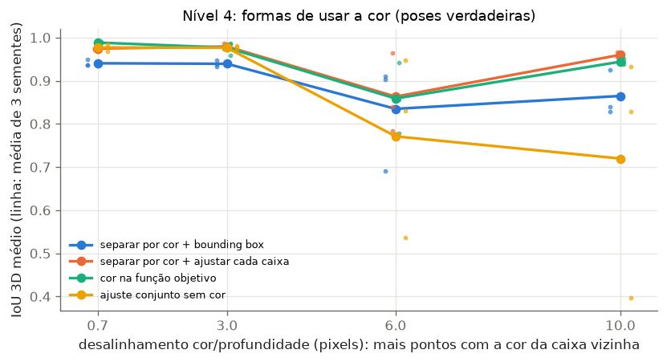
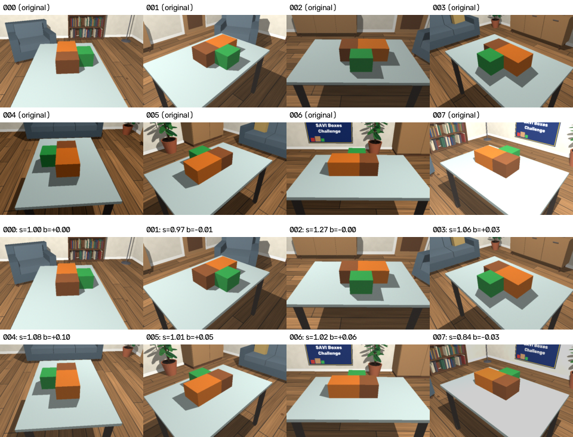
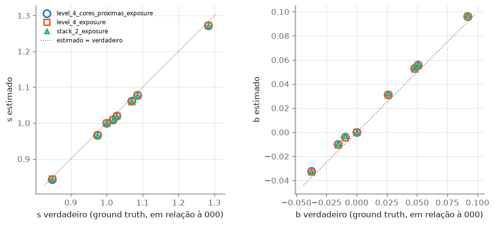
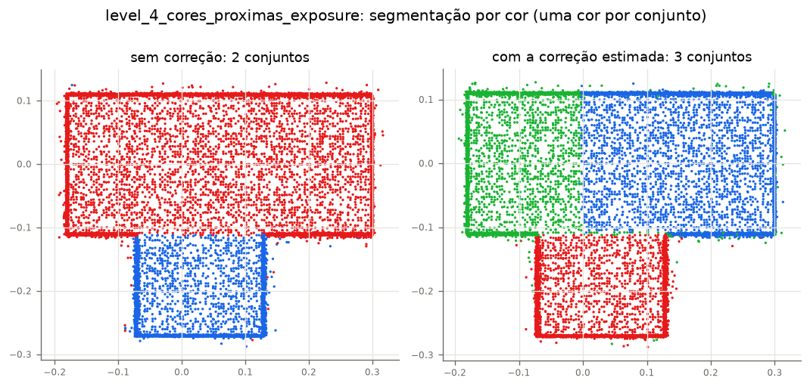
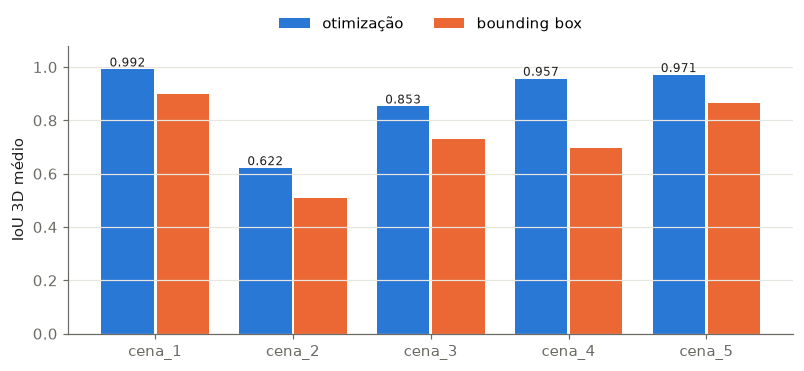
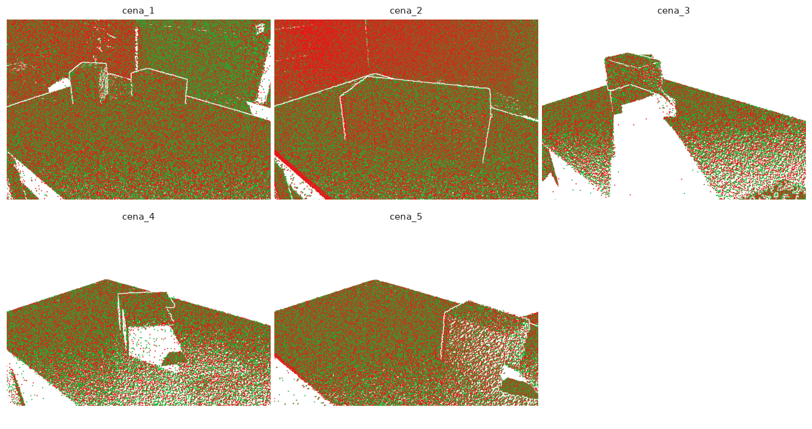
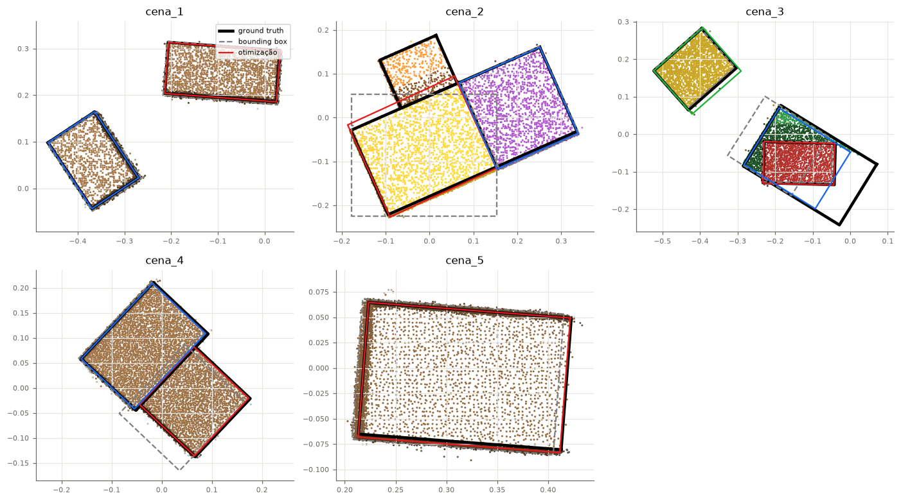
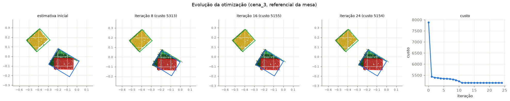
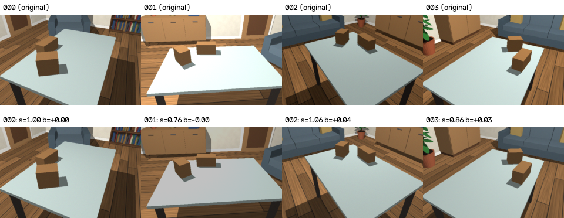

# SAVIBoxes — Trabalho Prático 1 de SAVI

Estimação da pose e das dimensões de caixas sobre uma mesa, a partir de várias imagens RGB-D.

O sistema tem 4 partes, que correm por esta ordem e passam os resultados umas às outras:

```
imagens RGB-D ──► Parte 1: registo ──► extra: fotometria ──► Parte 2: segmentação ──► Parte 3: ajuste ──► result.json
                  (poses das câmaras,   (s e b de cada        (mesa, objetos,           (bounding box e
                   nuvem agregada)       imagem, cores)        conjuntos de pontos)      otimização)
```

**Como está organizado este README.** A abordagem de cada parte, as respostas às questões do enunciado e
as dificuldades são fixas. Os resultados (imagens, gráficos e tabelas de erros) estão na secção
[Resultados do último teste](#resultados-do-último-teste), que o `run_test.py` reescreve no fim de cada teste
com as cenas que acabou de correr. As experiências usadas nas respostas às questões foram feitas com as
[cenas de desenvolvimento](#cenas-de-desenvolvimento) e não mudam com o teste.

## Índice

1. [Como correr](#como-correr)
2. [Cenas de desenvolvimento](#cenas-de-desenvolvimento)
3. [Parte 1 — Registo](#parte-1--registo)
4. [Parte 2 — Segmentação](#parte-2--segmentação)
5. [Parte 3 — Ajuste das caixas](#parte-3--ajuste-das-caixas)
6. [Níveis de dificuldade](#níveis-de-dificuldade)
7. [Extras](#extras)
8. [Dificuldades encontradas](#dificuldades-encontradas)
9. [Resultados do último teste](#resultados-do-último-teste)
10. [Como foram obtidos os resultados](#como-foram-obtidos-os-resultados)

**Fontes.** Em cada técnica indica-se de onde vem:

| sigla | fonte |
|---|---|
| **P02 … P08** | aulas da disciplina, repositório [`SAVI_26-27`](https://github.com/miguelriemoliveira/SAVI_26-27), pasta `ParteXX` e número do exercício |
| **O3D** | tutoriais e documentação do [Open3D](https://www.open3d.org/docs/release/) (o nome do tutorial vem indicado) |
| **CV** | documentação do OpenCV |
| **SP** | documentação do SciPy (`scipy.optimize.least_squares`) |
| **Nosso** | não vem das aulas nem de um tutorial: foi feito por nós para resolver um problema que encontrámos |

---

## Como correr

Todos os comandos correm na pasta principal do trabalho.

```
pip install -r requirements.txt
python simulator/savi_box_simulator.py --batch simulator/configs/level_*.json simulator/configs/stack_*.json --output scenes_offline
python savi/parte1_registo.py --scene scenes_offline/level_4 --visualize       # Parte 1: registo
python savi/extra_fotometria.py --scene scenes_offline/level_4 --visualize     # extra: fotometria
python savi/parte2_segmentacao.py --scene scenes_offline/level_4 --visualize   # Parte 2: segmentação
python savi/parte3_ajuste.py --scene scenes_offline/level_4 --visualize        # Parte 3: escreve result.json
python savi/avaliador.py --scene scenes_offline/level_4 --num_boxes 3          # compara com o ground truth: avaliacao.md
python run_test.py --scenes scenes_offline --output results_test               # tudo, em todas as cenas da pasta
```

Cada parte lê o que a anterior gravou em `<cena>/partes/`. O `ground_truth.json` só é lido pelo `avaliador.py`:
as partes nunca o leem. No fim, o `run_test.py` reescreve a secção [Resultados do último teste](#resultados-do-último-teste) deste README (`python savi/resultados_readme.py` faz o mesmo sem correr nada; `--sem_readme` desliga-o). As opções de cada ficheiro aparecem com `--help` (por exemplo,
`python savi/parte3_ajuste.py --help`).

| pasta | o que tem |
|---|---|
| `savi/` | o código: `parte1_registo.py`, `extra_fotometria.py`, `parte2_segmentacao.py`, `parte3_ajuste.py`, `avaliador.py` e o código comum (`comum.py`, `visualizacao.py`) |
| `simulator/` | o simulador do professor e as configurações das cenas usadas (`simulator/configs/*.json`) |
| `docs/` | as figuras deste README, os scripts que as geram (`gerar_figuras.py`, `experiencias.py`) e os resultados das experiências (`docs/resultados/*.json`) |
| `run_test.py` | corre todas as partes e o avaliador em todas as cenas de uma pasta |

---

## Cenas de desenvolvimento

São as cenas com que o sistema foi desenvolvido e com que foram feitas as experiências das respostas às questões (os resultados do teste estão na secção [Resultados do último teste](#resultados-do-último-teste)). Foram geradas com o simulador a partir das configurações em [`simulator/configs`](simulator/configs):
uma ou mais por nível, mais 3 pilhas (`stack_*`) e uma cena com cores próximas (`level_4_cores_proximas`, para o
extra). Todas têm 8 câmaras em anel e o ruído por omissão do `base.json`.


| configuração | nível | o que tem |
|---|---|---|
| `level_1` | 1 | uma caixa |
| `level_2` | 2 | 3 caixas separadas, da mesma cor |
| `level_3_heights` | 3 | caixas em contacto, alturas diferentes |
| `level_3_widths` | 3 | caixas em contacto, mesma altura e larguras diferentes |
| `level_3_rotated` | 3 | caixas em contacto, rodadas entre si |
| `level_3_aligned` | 3 | caixas com a mesma secção, perfeitamente alinhadas topo a topo (caso impossível) |
| `level_4` | 4 | caixas em contacto, cores diferentes |
| `stack_1`, `stack_2`, `stack_3` | 3 e 4 | caixas empilhadas: 2 da mesma cor; 2 de cores diferentes + 1 isolada; torre de 3 da mesma cor |
| `level_4_cores_proximas` | extra | como o `level_4`, com laranja e castanho em vez de vermelho e azul |

---

## Parte 1 — Registo

Ficheiro: [`savi/parte1_registo.py`](savi/parte1_registo.py). Objetivo: a pose `T_camera0_camera` de cada câmara e a
nuvem agregada no referencial da câmara 000.

As câmaras formam um anel. Cada câmara é registada com a vizinha (pares 0→1, 1→2, …), pelos 4 passos do enunciado,
e as poses são encadeadas: `T_0_(i+1) = T_0_i · T_i_(i+1)`.

### Passo 1 — Pré-processamento

| técnica | o que faz | parâmetros | fonte |
|---|---|---|---|
| filtro de profundidade | retira os pontos a mais de 3 m da câmara, antes do ICP | `MAX_DEPTH = 3 m` | **Nosso** (o ruído cresce com z²: a 4 m já é ~2.5 cm) |
| `voxel_down_sample` | um ponto por cubo: densidade uniforme e menos pontos | 4 escalas: 4, 2, 1 e 0.5 cm | **P07** Ex. 4; **P08** Ex. 2 |
| `remove_statistical_outlier` | retira pontos longe dos vizinhos (os *flying pixels* das arestas) | 20 vizinhos, 2 σ | **O3D** "Point cloud outlier removal" |
| `estimate_normals` | normal de cada ponto (o ICP ponto-a-plano precisa delas) | raio 3 × voxel, 30 vizinhos | **P07** Ex. 5 |

O pré-processamento faz-se uma vez por imagem e por escala do ICP. Sem o filtro de profundidade, o erro de registo
chegou a ser 24 vezes maior (`level_2` com 5 câmaras: 1.3 mm com o filtro, 30 mm sem ele).

### Passo 2 — Estimativa inicial

Cada ponto da nuvem vem de um pixel. Projetando a nuvem com a matriz K obtém-se o ponto 3D de cada pixel, e as
associações entre *features* das imagens passam a ser pares de pontos 3D (nota da P08, Ex. 3).

| técnica | o que faz | fonte |
|---|---|---|
| `cv2.SIFT_create` | *keypoints* e descritores em cada imagem | **P04** Ex. 2 |
| FLANN (`knnMatch`, k = 2) + teste da razão de Lowe (0.8) | associa os descritores e retira as associações ambíguas | **P04** Ex. 3 e 4 |
| pixel → ponto 3D | o pixel de cada *keypoint* dá o ponto 3D da nuvem (projeção com K) | **P08** Ex. 3 |
| `registration_ransac_based_on_correspondence` | transformação rígida a partir dos pares 3D, robusta às associações erradas, com os *checkers* de comprimento das arestas e de distância | **O3D** "Global registration" (para o qual a P08 remete) |
| RANSAC repetido sem os *inliers* anteriores | várias hipóteses por par (texturas repetidas dão modelos errados com muitos *inliers*) | a ideia da deteção sucessiva de planos da **P07** Ex. 3 |
| ASIFT (`cv2.AffineFeature`) | quando o SIFT dá poucas associações: simula inclinações da imagem e dá 3 a 10 vezes mais associações corretas | **CV** (não está nas aulas) |
| hipóteses da mesa | cada câmara deteta sozinha o tampo (função da Parte 2); `T_a_b = T_a_mesa · Rz(0° ou 180°) · T_b_mesa⁻¹` fica a ~1 cm da solução | **Nosso** |

Entre câmaras a 45°, o SIFT dá só 2 a 13 associações corretas em centenas. As *features* 3D (FPFH, **O3D** "Global
registration") falharam em todos os pares: a cena está cheia de planos com descritores iguais.

### Passo 3 — ICP

| técnica | o que faz | fonte |
|---|---|---|
| `registration_icp` com `TransformationEstimationPointToPlane` | refina cada hipótese, sobre a **nuvem completa** (mesa, caixas e fundo), como o enunciado pede | **P08** Ex. 2 |
| ICP multi-escala | 4 escalas, do grosseiro para o fino (voxel 4 cm → 5 mm, distância máxima 1.5 × voxel) | **P08** Ex. 2.3; **O3D** "Colored point cloud registration" (multi-escala) |
| kernel robusto de Tukey (`TukeyLoss`) | reduz o peso dos pares errados no ICP | **O3D** "Robust kernels" |
| escolha da hipótese | fica a que melhor alinha as nuvens completas: pontos a menos de 2 cm **e** com cor parecida | **Nosso** |

### Passo 4 — Agregação

| técnica | o que faz | fonte |
|---|---|---|
| encadeamento das poses | `T_0_(i+1) = T_0_i · T_i_(i+1)` | **P08** Ex. 3 |
| grafo de poses com fecho de ciclo | aresta extra 7 → 0 e otimização do grafo (`PoseGraph`, `global_optimization`), que distribui o erro pelo anel | **O3D** "Multiway registration" |
| agregação na resolução original | cada nuvem original (sem *downsampling*) é transformada para o referencial da câmara 000 e juntada | **P08** Ex. 3 |

### Extras de robustez (não fazem parte dos 4 passos)

Foram precisos para o sistema não falhar nas cenas com poucas câmaras (2 a 4, num arco) ou com texturas repetidas.
São todos **Nosso**.

- **Validação de cada par:** se o melhor alinhamento tiver um *score* baixo (< 0.18; os pares corretos dão
  0.26–0.48), tenta-se outra vez com mais esforço (ASIFT, Lowe 0.9, 10 hipóteses). Se continuar baixo, essa aresta
  não é usada e a câmara é posicionada pelo outro lado do anel. Num teste, um só par falhado punha uma câmara a
  840 mm do sítio, e todas as seguintes também; com a validação, o erro máximo ficou em 1.2 mm.
- **Câmara acima da mesa:** uma hipótese só é aceite se cada câmara ficar pelo menos 10 cm acima do tampo visto pela
  outra (as hipóteses erradas do chão punham a câmara 2.2 m abaixo da mesa).
- **Teste do espaço livre:** cada pixel diz que entre a câmara e a superfície medida não há nada. Uma hipótese que
  põe mais de 10% dos pontos da outra câmara nesse espaço é descartada (corretas: 1–5%; erradas: 19–40%).
- **Exposição:** antes de comparar as cores de um par no *score*, a exposição da fonte é corrigida para a do alvo
  (`exposure_corrected`, P06 Ex. 2.2). Sem isto, com Exposure changes, todas as hipóteses tinham *score* ~0.003.

### Questões da Parte 1

**O que acontece ao ICP se retirar o fundo e deixar apenas a mesa e as caixas? Porquê?**

Para cada par de câmaras vizinhas, o ICP multi-escala (passo 3) partiu da pose verdadeira com um erro acrescentado
(3, 8 e 15 cm com 3°, 8° e 15°, em 5 direções aleatórias), duas vezes: com a nuvem completa e só com os pontos da
mesa e das caixas (recortados com o tampo verdadeiro, 5 cm de margem). "Converge" = acaba a menos de 5 mm e 0.5°
da pose verdadeira. 35 ICP por linha.

| cena | erro inicial | nuvem | converge | erro final (mediana) | erro final (percentil 90) |
|---|---|---|---|---|---|
| `level_1` | 3 cm, 3° | completa | 97% | 0.1 mm, 0.01° | 2 mm |
| | | só mesa e caixas | 100% | 0.1 mm, 0.01° | 1 mm |
| | 8 cm, 8° | completa | 63% | 0.3 mm | 469 mm |
| | | só mesa e caixas | 66% | 0.2 mm | **1575 mm** |
| | 15 cm, 15° | completa | 23% | 332 mm | 1023 mm |
| | | só mesa e caixas | 26% | 574 mm | **2975 mm** |
| `level_4` | 3 cm, 3° | completa | 100% | **0.8 mm**, 0.01° | 2 mm |
| | | só mesa e caixas | 100% | **2.0 mm**, 0.01° | 4 mm |
| | 8 cm, 8° | completa | 69% | **0.9 mm** | 422 mm |
| | | só mesa e caixas | 74% | **2.5 mm** | **854 mm** |
| | 15 cm, 15° | completa | 29% | 307 mm | 652 mm |
| | | só mesa e caixas | 37% | 150 mm, 15° (não se mexeu) | **2024 mm** |

O que acontece sem o fundo:

- **Converge quase as mesmas vezes.** A bacia de convergência é parecida (até ~5–8 cm), porque é o limiar da escala
  mais grosseira (6 cm) que a define. Nas duas versões, a estimativa inicial (passo 2) tem de ficar a poucos cm.
- **Fica menos exato.** Com 3 caixas (`level_4`), o erro final passa de 0.8 para 2.0–2.5 mm. A mesa é um plano: só
  fixa 3 graus de liberdade (a altura e as duas inclinações); a nuvem pode deslizar sobre ela e rodar em torno da
  normal sem que o erro mude. Quem fixa os outros 3 são as faces laterais das caixas, que são pequenas e têm poucos
  pontos. O fundo (paredes, móveis, rodapés) acrescenta muitas superfícies com orientações diferentes e torna o
  problema bem condicionado.
- **Quando falha, falha muito pior.** Sem nada à volta, a nuvem escorrega pelo plano da mesa até muito longe
  (percentil 90 de 1.6 a 3 m, contra 0.4 a 1 m com o fundo), ou não encontra correspondências e não se mexe (a
  mediana de 15° no `level_4` é o erro inicial).

Por isso o enunciado pede a nuvem completa: o fundo é a parte da cena com mais geometria e é o que condiciona o
ICP. Os pontos a mais de 3 m é que são retirados (passo 1), porque aí o ruído é de vários cm.

**O que acontece ao erro quando encadeia muitas imagens? A última imagem alinha com a primeira?**

O registo foi corrido duas vezes nas mesmas cenas: só com encadeamento (`--no_loop_closure`) e com o fecho de
ciclo e o grafo de poses.


| cena | método | erro de translação de cada câmara 001 … 007 (mm) | máximo |
|---|---|---|---|
| `level_1` | só encadeamento | 2.0, 1.8, 1.4, 1.5, 1.5, 1.5, **1.8** | 2.0 mm, 0.10° |
| | fecho de ciclo + grafo de poses | 1.9, 1.5, 1.1, 0.8, 0.2, 0.4, **0.7** | 1.9 mm, 0.07° |
| `level_4` | só encadeamento | 0.6, 0.6, 1.3, 2.5, 1.4, 2.7, **2.5** | 2.7 mm, 0.05° |
| | fecho de ciclo + grafo de poses | 1.4, 1.3, 1.3, 2.0, 1.1, 0.6, **1.2** | 2.0 mm, 0.06° |

- **O erro acumula-se.** Cada pose é o produto das transformações de todos os pares até ela,
  `T_0_7 = T_0_1 · T_1_2 · … · T_6_7`, e o erro de cada par entra em todas as câmaras seguintes. Como os erros dos
  pares têm direções aleatórias, somam-se como um passeio aleatório: crescem, em média, com √n, e nem sempre de uma câmara para a
  seguinte (no `level_4`, 0.6 mm na câmara 001 e 2.5–2.7 mm nas últimas). Um par errado estraga todas as câmaras a seguir (ver os extras de
  robustez: 840 mm num teste).
- **A última imagem não alinha exatamente com a primeira.** A câmara 007 fica a 1.8 mm (`level_1`) e 2.5 mm
  (`level_4`) do sítio, enquanto um só ICP entre duas câmaras vizinhas erra 0.1–1 mm: registar diretamente a 007 com a
  000 mostra esse desfasamento. Aqui é pequeno, porque cada ICP é muito preciso (0.1–1 mm, ver a questão anterior) e o anel só tem
  8 câmaras; com mais imagens, ou com pares menos precisos, cresce.
- **O fecho de ciclo** acrescenta a aresta 7 → 0 e o grafo de poses distribui o desfasamento pelo anel: as câmaras
  do fim, que têm o erro acumulado maior, são as que mais melhoram (`level_1`: 1.8 → 0.7 mm na 007; `level_4`:
  2.5 → 1.2 mm). As do princípio quase não mudam, ou ficam um pouco piores (`level_4`, câmara 001: 0.6 → 1.4 mm),
  porque recebem parte do erro das outras. O erro máximo desce pouco (2.0 → 1.9 mm e 2.7 → 2.0 mm).

**Que efeito têm os erros de registo na nuvem de pontos agregada?**

A cada pose verdadeira (exceto a da 000) foi acrescentado um erro de tamanho fixo em direção aleatória, e as
Partes 2 e 3 correram sobre a nuvem agregada assim obtida:


| erro em cada câmara | `level_1`: caixas / IoU otim. / IoU bbox | `level_4`: caixas / IoU otim. / IoU bbox |
|---|---|---|
| 0 | 1 / **0.996** / 0.943 | 3 / **0.986** / 0.948 |
| 2 mm e 0.2° | 1 / **0.985** / 0.907 | 3 / **0.968** / 0.901 |
| 5 mm e 0.5° | 1 / **0.922** / 0.792 | 4 / **0.899** / 0.796 |
| 10 mm e 1° | **5** / 0.191 / 0.258 | 3 / 0.214 / 0.282 |
| 20 mm e 2° | **6** / 0.379 / 0.378 | 4 / 0.581 / 0.328 |

Cada câmara põe as suas faces das caixas num sítio ligeiramente diferente, por isso, na nuvem agregada, as faces
ficam **duplicadas ou engrossadas**. Um erro de rotação pesa mais do que o de translação: as caixas estão a
~1.2 m das câmaras, e 1° a essa distância já desloca os pontos ~2 cm.

- **Erros pequenos (até ~2 mm e 0.2°):** as faces engrossam. A otimização, que usa todos os pontos, fica na média
  das cópias e quase não perde (IoU 0.97–0.99). A bounding box encosta-se à cópia mais de fora e cresce.
- **Erros médios (5 mm e 0.5°):** as dimensões passam a ter erros de 4–5 mm mesmo com a otimização, e a Parte 2
  já conta uma caixa a mais no `level_4`.
- **Erros grandes (≥ 1 cm e 1°):** as cópias das faces de câmaras diferentes ficam a mais de 1.5 cm umas das
  outras, o *clustering* e a contagem de topos veem várias caixas (5 ou 6 no `level_1`, que só tem uma) e os dois
  métodos falham.

Por isso o registo tem de ficar na ordem de 1–2 mm e abaixo de 0.1°, que é o que o sistema consegue (nas cenas
de desenvolvimento, no máximo 3.1 mm e 0.09°; ver também os [resultados do último teste](#resultados-do-último-teste)).

---

## Parte 2 — Segmentação

Ficheiro: [`savi/parte2_segmentacao.py`](savi/parte2_segmentacao.py). A segmentação é feita sobre a nuvem agregada.
A estrutura segue a solução da P08, Ex. 4 (chão → mesa → referencial da mesa → objetos → *clusters*).

| passo | técnica | fonte |
|---|---|---|
| 1. Mesa | normais (P07 Ex. 5) e só os pontos de superfícies horizontais, normal a menos de 10° da vertical (θ = arccos\|n·up\|) | **P07** Ex. 6 e 8 (RANSAC guiado pelas normais) |
| | **chão** = maior plano horizontal (`segment_plane`, RANSAC) | **P07** (`segment_plane`); **P08** Ex. 4 |
| | **mesa** = RANSAC nos pontos entre 0.5 e 1.0 m acima do chão; maior componente ligada do plano (DBSCAN) | **P08** Ex. 4 |
| | sentido "para cima": plano dos pontos do centro das imagens, com a normal virada para as câmaras (na P08 escolhe-se à mão) | **Nosso** |
| | referencial da mesa: origem no centro do tampo, z para cima, x ao longo do comprimento (`cv2.minAreaRect` do tampo) | **P08** Ex. 4; **CV** (`minAreaRect`) |
| 2. Retirar mesa e fundo | pontos entre 8 mm e 60 cm acima da mesa e dentro dos limites do tampo; voxel de 4 mm e remoção de *outliers* | **P08** Ex. 4 (lá até 40 cm; aqui há pilhas) |
| 3. *Clustering* | `cluster_dbscan`, eps = 1.5 cm; os *clusters* pequenos ficam de fora | **P07** Ex. 4; **P08** Ex. 4 |
| 4. Cor (Nível 4) | k-means (`cv2.kmeans`) na cromaticidade r = R/(R+G+B), g = G/(R+G+B), dentro de cada *cluster* com várias caixas; só se os grupos estiverem bem separados (distância entre centros > 4 × dispersão) | separar cor de brilho como o HSV da **P02**; k-means do **CV** |

**Porquê a cromaticidade:** uma sombra multiplica R, G e B pelo mesmo fator, que se cancela na divisão, por isso
todas as faces de uma caixa ficam com a mesma cor. A primeira versão usava (a\*, b\*) do Lab, que não cancela o
fator: nas faces escuras, um azul e um roxo deixaram de se distinguir (IoU 0.00–0.58; com (r, g) passou a
0.99). O `inRange` da P02 não serve, porque precisa de limites de cor conhecidos.

---

## Parte 3 — Ajuste das caixas

Ficheiro: [`savi/parte3_ajuste.py`](savi/parte3_ajuste.py). Dois métodos, aplicados aos mesmos conjuntos de pontos.

### Método base: bounding box

| técnica | o que faz | fonte |
|---|---|---|
| `get_minimal_oriented_bounding_box()` | caixa de menor volume de cada conjunto | **O3D**; **P08** Ex. 5 |
| *outliers* | `remove_statistical_outlier` e maior componente ligada (DBSCAN) | **O3D**; **P07** Ex. 4 |
| pontos extremos | cada dimensão vai do percentil 0.5 ao 99.5, e não do mínimo ao máximo | **Nosso** |
| referencial da caixa | o eixo mais alinhado com o z da mesa passa a ser a altura; a base é posta na mesa (ou no topo da caixa de baixo) | **P08** Ex. 5 ("o eixo z da OBB fica perpendicular à mesa?" — não fica) |

O corte dos percentis subiu o IoU médio da bounding box de 0.768 para 0.810 nas cenas de teste. A
`get_oriented_bounding_box()` (PCA) foi sempre pior (IoU 0.55 contra 0.77).

### Método principal: ajuste por otimização

Como nas P05 e P06, a função objetivo recebe os dados com `partial(objective_function, data=problem)` e devolve um
vetor de erros que o `least_squares` minimiza. Todas as caixas são ajustadas ao mesmo tempo.

| item do enunciado | o que foi feito | fonte |
|---|---|---|
| 1. Parâmetros | por caixa `x, y, yaw, length, width, height, z`, no referencial da mesa; `z` fixo em 0 nas caixas assentes na mesa | enunciado; **P05** (vetor de parâmetros) |
| 2. Função objetivo | **um erro por ponto**: distância à face mais próxima com orientação compatível com a normal do ponto, na caixa que melhor o explica (`min` sobre as caixas) | **P05**, **P06** Ex. 2.3 (um erro por pixel) |
| | **cobertura** (modelo → dados): amostras nas faces visíveis de cada caixa têm de ter pontos por perto | **Nosso** |
| | **sobreposição**: raiz da área de interseção entre cada par de caixas (`cv2.rotatedRectangleIntersection`), só se as alturas se cruzarem | enunciado (IoU); **CV** |
| | **apoio**: uma caixa empilhada assenta no topo da caixa de baixo | **Nosso** |
| | **pesos**: sobreposição e apoio × √M (M = n.º de pontos), cobertura × √(M / (N·S)), para cada grupo de erros valer o mesmo | **P06** Ex. 3 (os 4 erros × √n) |
| 3. Otimização | `scipy.optimize.least_squares`; as associações ponto → caixa são recalculadas **em cada avaliação** da função objetivo | **P05**; **SP** |
| 4. Estimativa inicial | retângulo de área mínima de cada *cluster* ou grupo de cor; nas caixas da mesma cor em contacto, divisão do topo por alturas, degraus do contorno ou partes iguais; corre a partir de duas estimativas e fica com a de menor custo | **P06** Ex. 6 (começar perto da solução); divisões: **Nosso** |
| 5. Pontos errados | `loss="soft_l1"`, `f_scale` = 4 mm | **P06** Ex. 5 |
| 6. Visualização | as caixas de cada avaliação ficam guardadas e são desenhadas no fim (animação 3D com `--visualize`) | **P05**/**P06** (desenho da evolução; aqui depois, porque cada iteração avalia a função 7N+1 vezes) |
| Cor (Nível 4) | cada caixa tem uma cor; o ponto escolhe a caixa que minimiza `d_geom² + (λ·d_cor)²` | **P06** Ex. 3 (ver [Nível 4](#nível-4-várias-caixas-em-contacto-de-cores-diferentes)) |

### Questões da Parte 3

**Uma caixa pode crescer sem que o erro aumente? Em que situações, e porquê? O que fez para o resolver?**

Sim. Com o erro dados → modelo, cada ponto só mede a distância à superfície mais próxima. Se a caixa crescer para o
espaço vazio, ou para trás de uma face que nenhuma câmara vê (a face de baixo, uma face encostada a outra caixa),
nenhum ponto fica mais longe e o erro não muda. Aconteceu no Nível 3 com alturas diferentes: a caixa baixa encolhia
~7 mm, porque os pontos do seu topo junto à caixa alta eram "explicados" pela face lateral da caixa alta.
Resolvido com:
- o termo de **cobertura** (modelo → dados): cada face visível tem de ter pontos por perto; uma caixa que cresce
  para o vazio tem amostras sem pontos e o erro aumenta. Só contam as faces viradas para alguma câmara e que não
  estão encostadas a outra caixa;
- a **compatibilidade das normais**: um ponto do topo (normal para cima) só é explicado por uma face de cima;
  explicá-lo com uma face lateral custa mais 2 cm.

**Duas caixas podem ocupar o mesmo espaço? O que acontece na otimização se isso for permitido?**

Sem nada que o impeça, sim: duas caixas podem colapsar sobre o mesmo grupo de pontos, porque ambas os explicam com
erro zero, e outra parte da nuvem fica sem caixa (ou é explicada por uma caixa esticada). Acontecia nas caixas da
mesma cor em contacto. O termo de **sobreposição** (área de interseção vista de cima, só quando os intervalos de
altura se cruzam) torna isso caro. Uma caixa empilhada não conta como sobreposição: está por cima, não dentro.

**Porque é que este ajuste dispensa um ciclo exterior que alterne entre associar os pontos às caixas e otimizar?**

Porque a associação é um `min` dentro da função objetivo: o erro de cada ponto é a distância à caixa que melhor o
explica, calculada em cada avaliação. Essa função é contínua nos parâmetros (o `min` de funções contínuas é
contínuo), e o `least_squares` vê, no jacobiano, o efeito de um ponto mudar de caixa. Não há associações fixas do
início que possam estar erradas, e a otimização converge para um mínimo da função que interessa, em vez de alternar
entre dois problemas.

**Que pontos determinam cada parâmetro? Um ponto no meio do topo da caixa ajuda a estimar o seu comprimento?**

Cada parâmetro é determinado pelos pontos cuja distância à superfície muda quando ele muda:
- `height` (e `z` numa caixa empilhada): os pontos do topo;
- `length`: os pontos das duas faces das extremidades ao longo de x (e os bordos do topo);
- `width`: os pontos das faces ao longo de y;
- `x`, `y`, `yaw`: os pontos das faces laterais.

Um ponto no meio do topo **não** ajuda a estimar o comprimento: a sua distância à superfície é a distância ao plano
do topo, que não muda se a caixa crescer ao longo de x. No jacobiano, a derivada desse resíduo em ordem a `length` é
zero. É por isso que uma caixa vista só de cima tem o comprimento mal determinado, e que a cobertura é precisa.

**Porque é que a bounding box é tão sensível ao ruído? Que pontos usa, afinal?**

A bounding box usa só os pontos extremos: os do invólucro convexo, que tocam nas faces da caixa. Os outros pontos
não contam. Os extremos são precisamente os mais ruidosos: *flying pixels* nas arestas e pontos com o maior erro de
profundidade. Um só ponto 1 cm fora alarga a caixa 1 cm. A otimização usa todos os pontos, cada um com um peso
limitado (perda robusta), e o ruído de média zero cancela-se. Cortar 0.5% dos pontos em cada extremo reduz o efeito,
mas não o elimina (ver o [Nível 1](#nível-1-uma-caixa): o erro da bounding box cresce linearmente com o ruído).

---

## Níveis de dificuldade

### Nível 1: uma caixa

*A bounding box resolve o problema. O ajuste por otimização traz alguma vantagem? A partir de que nível de ruído?*

A cena `level_1` foi gerada com o ruído de profundidade (`depth_std` e `flying_pixels`) multiplicado por um fator,
e as Partes 2 e 3 correram com as poses verdadeiras:


| ruído (× o do simulador) | IoU otimização | IoU bounding box | erro das dimensões: otimização | bounding box |
|---|---|---|---|---|
| 0 (sem ruído) | 0.992 | **1.000** | 0.5 mm | **0.0 mm** |
| 0.5 | **0.997** | 0.969 | **0.2 mm** | 2.3 mm |
| 1 (por omissão) | **0.997** | 0.944 | **0.1 mm** | 4.3 mm |
| 2 | **0.994** | 0.881 | **0.5 mm** | 9.2 mm |
| 4 | **0.981** | 0.801 | **0.9 mm** | 16.2 mm |

Sem ruído, a bounding box é exata e ganha (a otimização fica a 0.5 mm, pela perda robusta e pelo voxel de 6 mm).
**A partir de metade do ruído por omissão, a otimização já é melhor**, e a diferença cresce com o ruído: o erro da
bounding box cresce linearmente (~4 mm por unidade de ruído, porque se encosta aos pontos mais extremos), o da
otimização fica abaixo de 1 mm.

### Nível 2: várias caixas separadas, da mesma cor

Cada caixa é um *cluster* euclidiano, e os dois métodos aplicam-se a cada um. Os resultados são os do Nível 1: na
cena de desenvolvimento `level_2`, a otimização deu IoU 0.994 e a bounding box 0.921, com até 7 mm a mais nas
dimensões.

### Nível 3: várias caixas em contacto, da mesma cor

As caixas formam um só *cluster*, e a cor não as separa. A estimativa inicial divide o topo do *cluster*
(alturas diferentes, degraus do contorno, partes iguais) e a otimização corrige a divisão. Nas cenas de
desenvolvimento com alturas diferentes, larguras diferentes, rotações e pilhas (`level_3_*`, `stack_*`), o IoU da
otimização ficou entre 0.979 e 0.991, e o da bounding box entre 0.678 e 0.908.

**Casos impossíveis.** Caixas da mesma cor com a **mesma secção e perfeitamente alinhadas** são impossíveis de
separar: lado a lado, com a mesma largura e a mesma altura e as faces no mesmo plano (o caso "caixas iguais e
perfeitamente alinhadas" do enunciado, `level_3_aligned`), ou uma em cima da outra com o mesmo retângulo.

- A união das duas é um paralelepípedo perfeito, com o topo plano e as faces contínuas. Os pontos medidos são
  exatamente os de uma só caixa mais comprida (ou mais alta).
- A fronteira entre as duas não deixa nenhum vestígio: nem degrau, nem ângulo, nem cor. Qualquer posição da
  fronteira explica os pontos igualmente bem, ou seja, a função objetivo tem um vale plano: o custo é o mesmo para
  toda uma família de soluções (duas caixas de comprimentos a e L − a, para qualquer a). Nem sequer se sabe se
  são duas caixas ou uma.
- Com alturas, larguras ou rotações diferentes, o contorno da união tem um degrau ou um ângulo que fixa a
  fronteira. É essa informação que falta no caso alinhado.

O sistema confirma-o. Na `level_3_aligned` há duas caixas com 0.20 × 0.15 m de secção, de comprimentos 0.35 m e
0.15 m, encostadas topo a topo. A Parte 2 encontra **uma** caixa, e a Parte 3 ajusta-lhe a união das duas:
0.500 × 0.201 × 0.150 m, para 0.50 × 0.20 × 0.15 m verdadeiros. As dimensões exteriores estão certas ao milímetro;
o que não se pode saber é onde fica a junta. A caixa estimada é associada à caixa verdadeira maior (IoU 0.691, perto
de 0.35 / 0.50 = 0.70; o comprimento fica +150 mm, o comprimento da outra caixa) e a outra caixa conta com IoU 0,
o que dá 0.346. Com uma versão anterior, que recebia o número de caixas e ajustava duas, a junta ficava ~10 cm
fora do sítio (IoU 0.645), embora a união estivesse certa: é o vale plano da função objetivo.

### Nível 4: várias caixas em contacto, de cores diferentes

A cor separa as caixas. Foram comparadas as três abordagens do enunciado, mais o ajuste sem cor, na cena
`level_4` com o desalinhamento entre a cor e a profundidade (`misalignment_px`) a aumentar: quanto maior, mais
pontos junto às fronteiras ficam com a cor da caixa vizinha. Poses verdadeiras, 3 sementes do ruído por valor.



IoU 3D médio das 3 caixas (média das 3 sementes; entre parênteses, a pior semente):

| desalinhamento | separar por cor + bounding box | separar por cor + ajustar cada caixa | cor na função objetivo | ajuste conjunto sem cor |
|---|---|---|---|---|
| 0.7 px (por omissão) | 0.940 (0.935) | 0.974 (0.972) | **0.988** (0.986) | 0.977 (0.969) |
| 3 px | 0.939 (0.932) | **0.979** (0.974) | 0.977 (0.959) | 0.976 (0.972) |
| 6 px | 0.835 (0.691) | **0.863** (0.784) | 0.859 (0.777) | 0.771 (0.536) |
| 10 px | 0.865 (0.829) | **0.960** (0.955) | 0.944 (0.938) | 0.720 (0.397) |
| média | 0.895 | **0.944** | 0.942 | 0.861 |

*Qual é a mais robusta quando alguns pontos têm a cor errada?*

- **Separar por cor e aplicar a bounding box** é a pior das três: os pontos com a cor errada ficam no conjunto da
  caixa vizinha e, como a bounding box se encosta aos pontos extremos, a caixa estica até eles. Perde 0.07–0.10 de
  IoU logo com o desalinhamento por omissão.
- **Separar por cor e ajustar cada caixa** e **pôr a cor na função objetivo** ficam praticamente empatadas
  (0.944 e 0.942 em média). Com poucos pontos de cor errada (0.7 px), a cor na função objetivo é a melhor (0.988):
  um ponto de cor ligeiramente errada mas bem explicado pela geometria continua na caixa certa. Com muitos pontos de
  cor errada (10 px), ajustar cada caixa sozinha é um pouco melhor (0.960 contra 0.944). A explicação provável: os
  pontos com a cor errada ficam longe das faces da caixa a que foram atribuídos e a perda robusta (`soft_l1`) quase
  os ignora; na função objetivo, a cor continua a puxá-los para a caixa da sua cor. A diferença é pequena,
  comparada com a variação entre sementes.
- **Sem cor**, o ajuste conjunto aguenta o desalinhamento por omissão (0.977), mas quando a geometria não chega
  (mais desalinhamento, mais pontos misturados nas fronteiras) cai para 0.40–0.54 na pior semente. A cor é
  precisa.
- A 6 px todos os métodos caem, porque a falha vem antes, da segmentação: os pontos misturados das fronteiras
  contaminam um dos grupos de cor e a terceira caixa começa com o tamanho da vizinha (0.30 × 0.22 m em vez de
  0.22 × 0.18 m). A 10 px, numa semente, as cores misturadas chegam a formar um 4.º grupo de cor e a Parte 2 conta 4
  caixas em vez de 3 (o número de caixas é estimado, não dado).

A abordagem usada no sistema é a cor na função objetivo, que é a melhor com o ruído do simulador por omissão e fica
a menos de 0.02 da melhor nos outros casos.

**Como pesar os erros geométricos e os erros de cor (P06, Ex. 3)?** Na P06 o problema é o mesmo: somar erros de
grandezas diferentes. Aqui, cada erro é dividido pelo seu desvio padrão, para 1 desvio de cor valer o mesmo que 1
desvio de distância: λ = σ_geom / σ_cor, com σ_geom = 3 mm (o ruído geométrico típico) e σ_cor estimado de forma
robusta em cada cena (1.4826 × mediana da distância de cor de cada ponto à cor da caixa mais parecida). Um ponto
escolhe a caixa que minimiza `d_geom² + (λ·d_cor)²`. Com λ muito grande, a cor manda e os pontos com a cor errada
puxam a caixa errada (é o mesmo que separar primeiro por cor); com λ = 0 volta-se ao Nível 3. Os termos que são
poucos (sobreposição, apoio) usam o outro peso da P06 Ex. 3, × √M, para valerem tanto como os M erros dos pontos.

---

## Extras

### Correção fotométrica

Ficheiro: [`savi/extra_fotometria.py`](savi/extra_fotometria.py). Corre entre a Parte 1 e a Parte 2. Com a opção
**Exposure changes** do simulador, cada imagem k tem o seu ganho e o seu desvio, `cor_k = s_k · cor + b_k`.
O modelo é o da P06: `I' = s · I + b`.

| passo | técnica | fonte |
|---|---|---|
| 1. Pontos vistos por mais do que uma câmara | para cada par de câmaras, as duas nuvens vão para o referencial da câmara 0 (poses da Parte 1), voxel de 1 cm, e os pares de pontos a menos de 1 cm são as correspondências do ICP com a identidade (`evaluate_registration(...).correspondence_set`); ficam de fora as cores cortadas a 0 ou 1; até 3000 pares por par de câmaras | **P07** (voxel); **P08** (correspondências do ICP); **P06** Ex. 3 (tirar a zona onde o modelo não vale) e Ex. 2 (menos dados) |
| 2. s e b de cada imagem em relação à 000 | uma só otimização com `least_squares`: um erro por par de pontos e por canal, `(s_i·cor_i + b_i) − (s_j·cor_j + b_j)`, com a 000 fixa em s = 1, b = 0; entram todos os pares de câmaras; `bounds` e `loss="cauchy"` | **P06** Ex. 2.1, 2.2 e 2.3, Ex. 4.3 (`bounds`), Ex. 5 (perda robusta) |
| 3. Imagens corrigidas | `I' = s · I + b`, limitado a [0, 1] | **P06** Ex. 1 |
| 4. Nuvens coloridas de novo | cada ponto é projetado com K no seu pixel da imagem corrigida (`u = fx·x/z + cx`) | **Nosso** (inverso da passagem imagem de profundidade → nuvem) |

A 000 tem de ficar fixa: se também pudesse mudar, a solução degenerava (todas as imagens pretas dão erro zero,
P06 Ex. 2.1). Uma imagem sem nada em comum com a 000 fica ligada a ela através das outras.

Mosaico das imagens (`level_4_cores_proximas` com Exposure changes): em cima as originais, em baixo as corrigidas,
com o s e o b estimados de cada uma. Depois da correção, a mesa e as caixas ficam com o mesmo brilho em todas as
imagens (ver a 002, muito escura, e a 007, muito clara).



**Escolha da perda** (poses verdadeiras, `level_4` com Exposure changes, erro médio nas imagens 001–007):

| perda | erro de s | erro de b |
|---|---|---|
| nenhuma (mínimos quadrados) | 0.138 | 0.078 |
| `soft_l1` (P06 Ex. 5), `f_scale` 0.02 | 0.030 | 0.018 |
| `cauchy`, `f_scale` 0.01 | **0.007** | **0.005** |

Com a `soft_l1`, o s de todas as imagens ficava ~3% abaixo do verdadeiro: os pares de pontos que não são o mesmo
ponto (arestas, sombras, cores misturadas) puxam o declive para baixo. A `cauchy` é o mesmo argumento `loss` do
`least_squares`, mas dá ainda menos peso aos erros grandes.

**Comparação com o `photometry` do ground truth.** O campo dá `cor_k = s_k · cor + b_k`; em relação à 000,
`s = s_000 / s_k` e `b = b_000 − s_000 · b_k / s_k`. Com as poses estimadas pela Parte 1:



| cena | erro médio de s | erro médio de b | erro de cor nos pontos comuns: antes → depois | IoU otimização |
|---|---|---|---|---|
| `level_4` com Exposure changes | 0.008 | 0.005 | 0.099 → 0.023 | 0.978 |
| `stack_2` com Exposure changes | 0.009 | 0.006 | 0.100 → 0.025 | 0.981 |
| `level_4_cores_proximas` com Exposure changes | 0.008 | 0.005 | 0.098 → 0.023 | 0.963 |
| `level_4_cores_proximas` **sem** Exposure changes | 0.008 | 0.005 | 0.019 → 0.019 | 0.954 |

O erro de cor depois da correção (~0.023) é praticamente o mesmo que se obtém com o s e o b verdadeiros: o que
sobra é ruído de cor, desfoque e pares de pontos que não são o mesmo ponto. Há um pequeno viés: numa cena **sem**
Exposure changes (s = 1 e b = 0 verdadeiros em todas as imagens), a estimativa dá s ≈ 0.99 e b ≈ +0.007 em todas.
É o mesmo erro (~0.008) que nas cenas com Exposure changes, por isso é o limite do método: os pares errados que
sobram puxam o declive ligeiramente para baixo, mesmo com a perda `cauchy`. Não tem efeito na segmentação.

**Efeito na segmentação por cor do Nível 4.** O avaliador corre a Parte 2 três vezes sobre a nuvem com as poses
verdadeiras: sem correção, com a correção estimada e com a verdadeira.

| cena (com Exposure changes) | cores | conjuntos (3 caixas) | precisão | *recall* |
|---|---|---|---|---|
| `level_4` (vermelho, azul, verde) | sem correção | 3 | 0.990 | 0.665 |
| | estimada / verdadeira | 3 | 0.991 | 0.665 |
| `level_4_cores_proximas` (laranja, castanho, verde) | sem correção | **2** (laranja e castanho juntos) | **0.790** | 0.673 |
| | estimada / verdadeira | 3 | 0.980 | 0.661 |



Com cores muito diferentes, a correção não muda nada: a cromaticidade cancela o ganho s, e o desvio b não chega para
trocar vermelho por azul. Com cores próximas, o b muda a cromaticidade de cada imagem de forma diferente, as nuvens
das duas caixas misturam-se e o k-means junta-as. Com a correção estimada, o resultado é igual ao da correção
verdadeira. No sistema completo (IoU 3D médio da otimização):

| cena | sem Exposure changes | com Exposure changes |
|---|---|---|
| `level_4` | 0.986 | 0.978 |
| `stack_2` | 0.980 | 0.981 |
| `level_4_cores_proximas` | 0.954 | 0.963 |

### Cores semelhantes

A cena `level_4_cores_proximas` ([`simulator/configs/level_4_cores_proximas.json`](simulator/configs/level_4_cores_proximas.json))
tem a geometria do `level_4` com uma caixa laranja e outra castanha encostadas. A cromaticidade separa-as (IoU 0.954
sem Exposure changes, 0.963 com a correção fotométrica); sem a correção fotométrica, com Exposure changes, deixam de
se separar (ver acima).

### Número de caixas desconhecido

As 4 partes **não usam o número de caixas**: a Parte 2 estima-o, e só o avaliador recebe o número real, para o
comparar. Em cada *cluster*, o número de caixas é o maior de 4 contagens (**Nosso**):

1. **alturas:** topos a alturas diferentes (pilhas, caixas de alturas diferentes);
2. **cores:** grupos de cor (Nível 4);
3. **juntas no topo:** o topo é cortado em fatias de 1 cm ao longo da fila; uma junta é um salto do centro (> 5 mm)
   ou da largura (> 1.5 cm) do topo;
4. **rotações:** a direção das paredes (normais quase horizontais, P07 Ex. 5–7), módulo 90°; cada pico do
   histograma circular é uma caixa rodada.

O número de caixas ficou certo em 9 das 10 cenas de desenvolvimento. Falha onde tem de falhar, no caso impossível
(`level_3_aligned`: 1 em vez de 2). Também falha quando a nuvem tem defeitos que parecem juntas: com erros de registo
de 5 mm e 0.5° no `level_4` contou 4 caixas, e com 1 cm e 1° no `level_1` contou 5 (ver a terceira questão da
Parte 1); com muito desalinhamento entre a cor e a profundidade, as cores misturadas das fronteiras formam um
4.º grupo de cor (Nível 4).

---

## Dificuldades encontradas

- **Registo com 45° entre câmaras.** O SIFT dava poucas associações corretas e as texturas repetidas (tábuas do
  chão, livros) davam modelos errados com mais *inliers* do que o correto. O FPFH falhou em todos os pares.
  Resolvido com o ASIFT, várias hipóteses por par, a escolha pelo alinhamento das nuvens completas com cor, a
  validação de cada par e o grafo de poses. Foi a parte que levou mais tempo.
- **Poucas câmaras.** Com 2 a 4 câmaras num arco, não há fecho de ciclo e um par falhado não tem alternativa. As
  hipóteses da mesa e o teste do espaço livre resolveram (IoU médio de 0.21 para ~0.97 nessas cenas).
- **Deteção da mesa.** O chão tinha mais pontos do que o tampo, e o RANSAC encontrava planos que cortavam paredes na
  diagonal. Resolvido encontrando primeiro o chão, só com pontos de normal vertical, e procurando a mesa entre 0.5 e
  1.0 m acima dele (P08 Ex. 4).
- **Cor das faces escuras.** Em Lab, as faces na sombra perdiam a cor; a cromaticidade (r, g) resolveu.
- **Mínimos locais na otimização.** Com caixas da mesma cor em contacto, uma estimativa inicial má (o k-means
  dividia o topo ao meio, até 11 cm fora do sítio) deixava a otimização presa (IoU 0.21–0.60). Resolvido com a
  divisão pelos degraus do contorno e o *multi-start* (duas estimativas iniciais, fica a de menor custo).
- **Caixas a crescer, a encolher e a sobrepor-se** sem o erro mudar: resolvido com a cobertura, as normais e a
  sobreposição (ver as questões da Parte 3).
- **Pilhas da mesma cor, com a caixa de cima rodada.** O topo da caixa de baixo só se vê em pedaços; foi preciso
  juntar os pedaços à mesma altura e usar as paredes laterais (IoU de 0.46–0.49 para 0.97–0.98).
- **Exposure changes.** Sem corrigir a exposição, o registo escolhia a hipótese errada (uma câmara a 2.35 m do
  sítio), e a primeira correção fotométrica, em cadeia, acumulava erro ao longo das imagens.
- **OpenCV no Windows.** O `cv2.imwrite`/`cv2.imread` não aceitam caminhos com acentos ("Trabalho prático"):
  as imagens não eram gravadas. Resolvido com `cv2.imencode(...).tofile(...)` e `cv2.imdecode` (também uma linha
  no simulador).

---

## Resultados do último teste

<!-- RESULTADOS:INICIO -->
_Secção gerada por `savi/resultados_readme.py` a partir de `results_test/` (2026-11-26 14:20), no fim do `run_test.py`. Não editar à mão: é substituída em cada teste._

5 cenas; 5 com ground truth; 2 com Exposure changes (cena_1, cena_2).


### Resumo

| cena | imagens | câmaras registadas | caixas encontradas / reais | IoU otimização | IoU bounding box |
|---|---|---|---|---|---|
| `cena_1` | 4 | 4 | 2 / 2 | **0.992** | 0.900 |
| `cena_2` | 3 | 3 | 2 / 3 | **0.622** | 0.508 |
| `cena_3` | 1 | 1 | 3 / 3 | **0.853** | 0.732 |
| `cena_4` | 2 | 2 | 2 / 2 | **0.957** | 0.697 |
| `cena_5` | 3 | 3 | 1 / 1 | **0.971** | 0.865 |
| **média** | | | | **0.879** | 0.740 |



### Parte 1 — Registo

Erro de cada câmara em relação ao ground truth (`E = T_gt⁻¹ · T_est`), média sem a câmara 000 e máximo; os erros de cada câmara estão em `results_test/<cena>/avaliacao.md`:

| cena | imagens | translação média (mm) | rotação média (°) | translação máx. (mm) | rotação máx. (°) |
|---|---|---|---|---|---|
| `cena_1` | 4 | 0.34 | 0.021 | 0.46 | 0.039 |
| `cena_2` | 3 | 4.75 | 0.043 | 5.13 | 0.050 |
| `cena_4` | 2 | 0.12 | 0.009 | 0.12 | 0.009 |
| `cena_5` | 3 | 2.94 | 0.090 | 3.56 | 0.135 |

Nuvem agregada de cada cena com as poses estimadas: cor dos pixels e uma cor por câmara.


Nuvem com as poses estimadas (vermelho) sobre a nuvem com as poses verdadeiras (verde), de perto:



### Parte 2 — Segmentação

Objetos isolados do resto da nuvem agregada (a cinzento), uma cor por conjunto de pontos:


Avaliação só da segmentação (nuvens juntas com as poses verdadeiras; pontos de cada caixa verdadeira com 5 mm de margem):

| cena | caixas encontradas / reais | precisão média | recall médio |
|---|---|---|---|
| `cena_1` | 2 / 2 | 0.983 | 0.704 |
| `cena_2` | 2 / 3 | 0.928 | 0.663 |
| `cena_3` | 3 / 3 | 0.997 | 0.715 |
| `cena_4` | 2 / 2 | 0.960 | 0.711 |
| `cena_5` | 1 / 1 | 0.985 | 0.741 |

O *recall* fica abaixo de 1 de propósito: a referência inclui os pontos até 8 mm acima da mesa e a margem de 5 mm, que a segmentação retira. Nas caixas da mesma cor em contacto, os conjuntos vêm da divisão inicial da Parte 3, que a otimização depois corrige.

### Parte 3 — Caixas

Vista de cima de cada cena (referencial da mesa): preto = ground truth, cinzento a tracejado = bounding box, cores = otimização.





Erros de cada caixa verdadeira (associação pelo IoU 3D, com as simetrias da caixa; dL, dW, dH = estimado − verdadeiro):

| cena | método | caixa | posição (mm) | altura z (mm) | yaw (°) | dL (mm) | dW (mm) | dH (mm) | IoU 3D |
|---|---|---|---|---|---|---|---|---|---|
| `cena_1` | otimização | 0 | 0.5 | 0.0 | 0.10 | -0.2 | -0.3 | 0.2 | **0.989** |
| `cena_1` | otimização | 1 | 0.2 | 0.0 | 0.01 | 0.2 | -0.1 | -0.4 | **0.995** |
| `cena_1` | bounding box | 0 | 2.8 | 0.0 | 0.50 | 5.7 | 6.2 | 2.0 | 0.910 |
| `cena_1` | bounding box | 1 | 4.4 | 0.0 | 0.04 | 1.7 | 6.6 | 2.4 | 0.891 |
| `cena_2` | otimização | 0 | 6.0 | -0.0 | 0.79 | -3.0 | 20.9 | -0.0 | **0.897** |
| `cena_2` | otimização | 1 | 2.6 | -0.0 | 0.07 | 4.6 | 1.7 | -0.0 | **0.968** |
| `cena_2` | otimização | 2 | - | - | - | - | - | - | **0.000** |
| `cena_2` | bounding box | 0 | 15.3 | -0.0 | 23.84 | 60.7 | 66.7 | 2.4 | 0.594 |
| `cena_2` | bounding box | 1 | 4.3 | -0.0 | 0.54 | 8.6 | -1.6 | 2.8 | 0.930 |
| `cena_2` | bounding box | 2 | - | - | - | - | - | - | 0.000 |
| `cena_3` | otimização | 0 | 38.6 | -0.0 | 0.19 | -77.0 | -12.6 | 0.1 | **0.693** |
| `cena_3` | otimização | 1 | 0.9 | 0.1 | 0.01 | -1.4 | 0.8 | -0.3 | **0.981** |
| `cena_3` | otimização | 2 | 7.5 | 0.0 | 0.06 | 3.6 | 14.2 | 0.0 | **0.885** |
| `cena_3` | bounding box | 0 | 99.9 | 0.0 | 0.76 | -99.4 | -3.6 | 26.0 | 0.385 |
| `cena_3` | bounding box | 1 | 6.5 | 1.7 | 0.74 | -5.4 | -2.1 | -0.3 | 0.876 |
| `cena_3` | bounding box | 2 | 3.7 | 0.0 | 0.10 | -1.4 | -3.7 | 0.9 | 0.934 |
| `cena_4` | otimização | 0 | 2.6 | -0.0 | 0.19 | -1.7 | 0.1 | -0.0 | **0.957** |
| `cena_4` | otimização | 1 | 2.6 | -0.0 | 0.01 | -2.5 | -4.1 | 0.0 | **0.957** |
| `cena_4` | bounding box | 0 | 31.7 | -0.0 | 0.26 | 30.1 | 15.8 | 27.6 | 0.525 |
| `cena_4` | bounding box | 1 | 7.7 | -0.0 | 0.33 | 0.2 | -6.1 | 2.1 | 0.870 |
| `cena_5` | otimização | 0 | 1.6 | -0.1 | 0.03 | -1.0 | 3.1 | 0.1 | **0.971** |
| `cena_5` | bounding box | 0 | 6.9 | -0.1 | 0.06 | -1.6 | 8.9 | 2.6 | 0.865 |

### Extra — Correção fotométrica

| cena | imagem | s estimado | b estimado | s verdadeiro | b verdadeiro | erro de s | erro de b |
|---|---|---|---|---|---|---|---|
| `cena_1` | 000 | 1.000 | +0.000 | 1.000 | +0.000 | 0.000 | 0.000 |
| `cena_1` | 001 | 0.757 | -0.001 | 0.760 | -0.004 | 0.003 | 0.002 |
| `cena_1` | 002 | 1.063 | +0.043 | 1.067 | +0.040 | 0.004 | 0.002 |
| `cena_1` | 003 | 0.865 | +0.034 | 0.867 | +0.033 | 0.002 | 0.002 |
| `cena_2` | 000 | 1.000 | +0.000 | 1.000 | +0.000 | 0.000 | 0.000 |
| `cena_2` | 001 | 1.118 | +0.076 | 1.122 | +0.073 | 0.004 | 0.003 |
| `cena_2` | 002 | 1.059 | +0.081 | 1.063 | +0.078 | 0.004 | 0.003 |

- `cena_1`: erro de cor nos pontos vistos por mais do que uma câmara 0.116 sem correção → 0.021 com correção.
- `cena_2`: erro de cor nos pontos vistos por mais do que uma câmara 0.101 sem correção → 0.025 com correção.

Imagens de `cena_1`: em cima as originais, em baixo as corrigidas.



<!-- RESULTADOS:FIM -->

---

## Como foram obtidos os resultados

- **Resultados do último teste:** `python run_test.py` (ou `python run_test.py --download <link>` no dia da
  apresentação) corre as cenas de `test/` e, no fim, reescreve essa secção com `savi/resultados_readme.py`: as
  tabelas vêm do `avaliacao.md` de cada cena (só se a cena tiver `ground_truth.json`) e as figuras ficam em
  `docs/teste/`. Para a reescrever sem correr nada: `python savi/resultados_readme.py --results results_test --scenes test`.
- **Experiências das respostas às questões** (ICP sem fundo, encadeamento, efeito do registo, ruído no Nível 1,
  cor no Nível 4), com as cenas de desenvolvimento: `python docs/experiencias.py --scenes <cenas>`; os
  resultados ficam em `docs/resultados/*.json` e as figuras são feitas com
  `python docs/gerar_figuras.py --results <saída do run_test.py>`.
- **Extra de fotometria:** cenas geradas com
  `python simulator/savi_box_simulator.py --batch simulator/configs/level_4.json simulator/configs/stack_2.json simulator/configs/level_4_cores_proximas.json --exposure_changes`.
